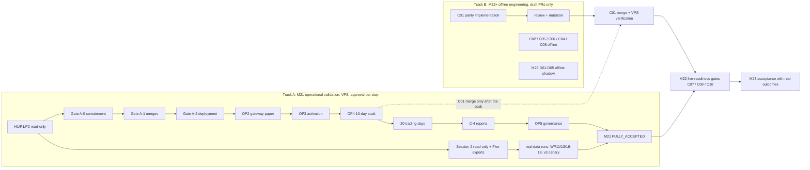

# Algo Trader — Roadmap

This is the canonical project roadmap. The **original 15-milestone plan stays
intact** at the top level; expansions (sub-milestones like M13.5.A–D, M14.A–H,
M15.1–3) live inside the parent milestone and are tracked in
[`MILESTONE_STATUS.md`](MILESTONE_STATUS.md). Do not reorder, compress, or
delete milestones.

For the live state of every milestone (✅ closed / ⚠ partial / ⏳ pending /
🔄 superseded), see [`MILESTONE_STATUS.md`](MILESTONE_STATUS.md). For a
narrative snapshot of where the project is right now, see
[`docs/PROJECT_STATUS_RECONCILIATION.md`](docs/PROJECT_STATUS_RECONCILIATION.md).

> **Roadmap v3.0 (DRAFT, 5 Nov 2026).** The numbering reconciliation, the M21 dimension summary, the M22–M25
> definitions (M24/M25 UNDEFINED), the two work tracks, the status vocabulary, the version/timestamp convention, the
> update protocol, the handoff block and the append-only changelog are in **"Roadmap v3.0"** at the end of this file
> (R1–R16). Live status is in [`MILESTONE_STATUS.md`](MILESTONE_STATUS.md) (status 3.0.1). Nothing below was renumbered
> or removed.
>
> **State on 29 Oct 2026 (reconciled by M21 E7), kept for history.** `main` is `80b4343`. M21 follows the June 2026
> canonical roadmap (M21.U, M21.1, M21.1extra, M21.2–M21.7); see "M21 — canonical scope and status" below.
> The remaining M21 engineering exists as **draft PRs, not merged** (#12, #1, #14, #13, #15–#26, E1–E6 #27–#32),
> except a dashboard flow for changing templates through the Promotion & Approval process (A16; E6 is read-only);
> operational acceptance (OP1–OP5) and performance validation have **not started**. Nothing is live; the paper
> loop is not running. The paragraph below is the previous (June) snapshot, kept for history.
>
> **Previous state (post-M18 merge, read-only/shadow-only foundation).**
> `main` is at `264fba84`; M1–M17 are on main
> (M17 backtesting CLOSED, `test_m17_backtesting` 200 OK). **M18 — the ML
> strategy/criteria foundation — is CLOSED and merged to `main`**
> (`test_m18_ml` loader 669; see [`docs/M18_ACCEPTANCE.md`](docs/M18_ACCEPTANCE.md)).
> M18 is read-only/shadow-only: it is the ML foundation, **not** live trading
> and **not** M19 signal scoring. **M19, M20, and M21.1extra-D0/D1/D2 have since
> been delivered;** the current work item is M21.1extra-D3 (dashboard metrics),
> not started. See [`MILESTONE_STATUS.md`](MILESTONE_STATUS.md) for authoritative state.

---

## Original 15-Milestone Plan (intact)

### Milestone 1 — Stable Shadow-Mode Scanner ✅ CLOSED
**Goal:** Bot runs 24/7, fetches real market data, generates signals, logs to DB, sends Telegram alerts.
- Scans curated large-cap US symbols across 1D / 4H / 1H / 15m
- RSI + MACD + EMA + VWAP + volume confluence scoring
- SQLite signal storage with auto-migration
- Telegram alerts for manual review
- Flask dashboard on port 8080
- GitHub → server auto-sync via `sync.sh`

### Milestone 2 — Telegram from Dashboard ✅ CLOSED
**Goal:** Configure and test Telegram from the dashboard without touching `.env` manually.
- Enable/disable Telegram, set token and chat_id from UI
- "Find My ID" auto-fills chat_id from bot's recent messages
- Send Test button verifies configuration

### Milestone 3 — Dashboard Observability ✅ CLOSED
**Goal:** Dashboard alone is enough to understand what the bot is doing.
- Phase badge (scanning / cooldown / stopped / crashed) with live countdown
- Last cycle summary: signals, TFs, symbols, duration, TF pip strip
- System panel: mode, focus count, DB rows, Telegram status, interval
- Improved log colouring and Cycle events filter
- `data/bot_state.json` written atomically on every phase change

Closure note: completed after a GitHub/server branch reconciliation and JS fixes.

### Milestone 4 — Strategy Engine ✅ CLOSED
**Goal:** Strategy logic visible and editable from dashboard. No hidden hardcoding.
- All thresholds in `bot/strategy.py` (single source of truth)
- Dashboard Strategy tab: edit long/short rules, confluence, ATR risk, routing
- Validation, default-reset, and full audit trail with version numbers
- Scanner reads strategy from `data/strategy.json` on every cycle

### Milestone 5 — Backtesting ✅ CLOSED (accepted-enough; known limitations)
**Goal:** Walk-forward backtest using the exact same live strategy — no parallel code.
- `bot/backtest.py` calls live `compute()`, `score_timeframe()`, `load_strategy()`
- 3-tier cache (`bt_cache` → live bot cache → network with pacing + retry)
- Real cancel; status `running / done / partial / cancelled / timeout`
- Stats: win rate, profit factor, drawdown, annualised return, monthly breakdown, per-symbol, by timeframe, by TF combination, equity curve, benchmark vs SPY
- Dashboard Backtest tab + `backtest_cli.py`

**Known carry-forward:** Yahoo/cache rate limits and gaps. Backtesting is
accepted as functional; provider-side reliability tracked under M6/M15
hardening, not reopened in M5.

### Milestone 6 — Modular Data-Provider Architecture ✅ CLOSED
**Goal:** Clean provider abstraction so providers can be swapped without touching strategy or backtest code.
- `bot/providers/base.py` — abstract `DataProvider`
- `bot/providers/yfinance_provider.py` — current implementation
- `bot/providers/alpaca_provider.py` — alternate implementation present
- Config-selectable via `DATA_PROVIDER=…` in `.env`
- Dashboard shows active provider in System panel

### Milestone 7 — More Indicators / Richer Logging ✅ CLOSED
**Goal:** Add features needed by the ML pipeline.
- Per-signal `_ml_features` block attached in `bot/scanner.py` (indicator
  snapshot logged with every signal)
- Indicator periods exposed via `data/strategy.json`
- Feature payload powers `ml_train.py` (see M9)

### Milestone 8 — News / Sentiment Module ⚠ IMPLEMENTED (real, not closed-loop)
**Goal:** Pre-filter signals with news-sentiment alignment.
- `bot/sentiment/news_provider.py` (~456 lines) — real news integration via yfinance / Google News / AlphaVantage (not NewsAPI)
  with caching, error classification, fetch-success flags
- `bot/sentiment/disabled_provider.py` — opt-out path
- Pluggable via `get_sentiment_provider()`; sentiment applied inside the
  scanner cycle via `apply_sentiment(signal, sent_result, sent_mode)`
- `SentimentResult` dataclass; failure modes captured (`fetch_failed`,
  `keys_absent`, …)

**Honest gap:** macro/news aggregation across multiple sources and a
confidence-weighted sentiment score are not yet built. Current
implementation is single-provider, single-pass. Tracked for M18.

### Milestone 9 — ML Pipeline ⚠ INFRASTRUCTURE COMPLETE, NOT CLOSED-LOOP
**Goal:** XGBoost (or similar) model trained on accumulated signal data to filter low-quality setups.
- `ml_train.py` (~541 lines) — XGBoost meta-labeling with walk-forward
  cross-validation, calibrated probabilities, precision-recall, per-group
  evaluation, filter-comparison tables. Reads
  `data/ml/training_dataset.parquet` or scattered backtest reports.
- `ml_build_dataset.py` — dataset assembly.
- Data flywheel (M10+) feeds `candidate_snapshots` / `execution_intents` /
  `signal_outcomes`.

**Honest gap:** model is NOT yet wired into scanner.py as a live filter.
Closed-loop self-learning (train → predict → filter → outcome → retrain) is
deferred. Today: trains and evaluates only.

### Milestone 10 — Broker Execution Architecture ✅ CLOSED
**Goal:** Clean broker abstraction; no live execution as part of this milestone.
- `bot/brokers/base.py` — `BrokerAdapter`, `OrderIntent`, `OrderResult`
- `bot/brokers/paper_broker.py` — paper path
- `bot/brokers/ibkr_broker.py` — IBKR adapter
- Broker registry with `BROKER=` env switching
- Flywheel schema (`execution_intents`, `candidate_snapshots`, `signal_outcomes`)

### Milestone 11 — IBKR Paper Trading ✅ CLOSED
**Goal:** Automated order placement on IBKR paper account.
- `bot/brokers/ibkr_broker.py` (via `ib_insync`) wired to paper port 4002
- IBC 3.22.0 headless IB Gateway, systemd-managed, `Restart=always`
- `test_m11.py` confirms paper login flow

### Milestone 12 — IBKR Live Trading ✅ CLOSED (capability proven; sustained live trading is post-M14)
**Goal:** Real-money execution on IBKR.
- Live Gateway on port 4001 (`config.live.ini`, `start_ibgateway_live.sh`,
  `/var/lib/ibgateway-live`); nightly `AutoRestartTime=23:45`
- Real broker acceptance proven by a controlled live order (Ford/F, 1 share,
  delayed market data) with confirmed `permId`; `execution_intents` row
  reflects the truthful state; position cancelled cleanly afterwards.
- `test_m12.py` (offline 13 tests) + `test_m12_live_order.py` (`--live` flag,
  Gateway connection + reconciliation)

### Milestone 13 — eToro Integration / Manual Bridge ✅ CLOSED (capability built; first funded order is separate)
**Goal:** eToro live-write capability, built / gated / reviewed / deployed / no-write verified.
- See `docs/M13_7_closeout.md` for the full chain (61a→f7a3bc2) and the
  13 safety invariants with their 173 proving tests in `test_m13_5_*.py`.
- Demo disabled (fail-closed); `--base-url` removed; real mode pinned to
  `https://public-api.etoro.com`; double live flag + per-payload nonce;
  scanner-isolation invariant maintained.
- **Zero real eToro orders placed.** First funded order remains a separate
  later go-live event (not part of M13, not part of M14).

### Milestone 14 — Portfolio / Risk Layer ✅ CLOSED (A through H)
**Goal:** Risk Intelligence Layer — broker-scoped state, exposure, decision
core + governor, eToro preflight integration, dashboard, closeout.

**Authoritative closeout document:** [`docs/M14_FINAL_AUDIT.md`](docs/M14_FINAL_AUDIT.md).

- **M14.A** design doc (CLOSED, `3f4448e`).
- **M14.B** additive `daily_state_per_broker` + `risk_snapshots` +
  `risk_decisions` + `broker_positions` schema; legacy `daily_state` untouched (CLOSED, `42ee08c`).
- **M14.C** read-only realised-PnL ingestion adapters (IBKR + eToro) with
  fail-closed semantics; CLI `tools/ingest_risk_state.py` (CLOSED, `d9c53eb`).
- **M14.D** read-only exposure/positions adapters + `broker_positions` batch
  schema + cross-engine separation; CLI `tools/ingest_exposure_state.py`
  (CLOSED, `729ad2d`).
- **M14.E** Risk Authority Engine + downgrade-only governor; pure `decide()`,
  25 gates, 31 reason codes, M13.4A policy bridge, `decide_and_audit`
  thin wrapper as the only DB-writing surface (CLOSED, `ace0fda`,
  `test_m14_e_engine.py` 105/105).
- **M14.F** eToro live-write preflight integration — `run_risk_preflight`
  inserted before transport/env/nonce/broker construction; exit 4 on block
  (CLOSED, `2e20b52`, `test_m14_f_preflight.py` 34/34).
- **M14.G** read-only Risk Authority dashboard tab + 4 GET endpoints
  (CLOSED, `71e893a`, `test_m14_g_dashboard.py` 51/51).
- **M14.H** Closeout / audit doc — this document + `docs/M14_FINAL_AUDIT.md`
  (CLOSED).

**M14 totals:** 9 commits, ~12,321 lines, 17 new modules, 324 sub-milestone tests, 0 real-money orders placed, 0 bypasses around Risk Authority.

### Milestone 15 — Production Hardening ⚠ PARTIAL
**Goal:** Monitoring, alerting, failover, full audit log, compliance-grade logging.
- **M15.0-pre** Flywheel schema (CLOSED, prerequisite for M14; originally
  labelled M15.0 — renumbered to disambiguate from the production-process
  M15.0 that closed 2026-06-02).
- **M15.1** Gateway state + reconciliation tooling (CLOSED, `test_m15_gateway.py` 33/33).
- **M15.2** Health endpoint + external monitoring (CLOSED, `test_m15_2_health.py` 28/28, `docs/M15_2_external_monitoring.md`).
- **M15.0** ✅ CLOSED — Scanner / systemd reliability + production process
  clarity (commit chain `57dc200` → `597635d`, `test_m15_0_service.py` 40/40).
  Canonical systemd units installed and active on the VPS:
  `algo-trader.service` (main bot/scanner) and
  `algo-trader-dashboard.service` (Flask dashboard). VPS verification
  2026-06-02: both PIDs owned by `/system.slice/<unit>`, both
  active/enabled, exactly one of each process, `/api/health` HTTP 200.
  Rollback snapshot: `/var/lib/algo-trader/m15_0_snapshots/20260602T210527Z`.
  New read-only `/api/system/services` endpoint reports the canonical
  service map; auth-protected (returns `{"error":"Unauthorized"}` to
  unauthenticated callers — expected behaviour). `deploy.sh` + `sync.sh`
  are systemd-aware with verbatim legacy nohup fallback for pre-install
  and post-rollback states. Authoritative reference:
  `docs/M15_0_systemd_canonical.md`.
- **M15.4** ✅ CLOSED — IB Gateway reliability + broker connectivity
  health (visibility/truth layer) (commit `073a8bd`,
  `test_m15_4_gateway_health.py` 47/47). New read-only helper
  `bot/gateway_health.py` combines `systemctl is-active/is-enabled/show`,
  TCP connect-and-close probe on 4001/4002, trading-mode discovery
  from `start_ibgateway.sh` + IBC config, `/var/log/ibgateway/ibgateway.log`
  tail, and `journalctl -u ibgateway.service` into a single
  point-in-time classification (`service_down`,
  `service_active_port_closed`, `service_active_login_error`,
  `service_active_api_port_open`, `unknown`). New endpoint
  `GET /api/gateway/health` — auth-protected, returns HTTP 401 to
  unauthenticated callers (confirmed on VPS after dashboard restart);
  existing M15.1 `/api/gateway/state` preserved unchanged. **No IB
  API call was added** — `reqCurrentTime` / `ib.connect` / `placeOrder`
  / `cancelOrder` are AST-asserted absent. Reference mirror of
  production `ibgateway.service` at
  `infra/systemd/ibgateway.service.documented` (not installed by any
  script). VPS classification on closeout day: `ibgateway.service`
  active/enabled but **no listener on either 4001 or 4002**, log
  shows a login/authentication error → `status =
  service_active_login_error`, `ready_for_ibkr_trading = False`.
  This is the headline value: systemd "active" is no longer
  conflated with "IBKR trading is ready". Authoritative reference:
  `docs/M15_4_ib_gateway_runbook.md`.
- **M15.5** ✅ CLOSED — IBKR exposure reader wiring (paper mode)
  (commits `138df9e` → `2446df6`, `test_m15_5_ibkr_exposure.py`
  78/78). The `NotImplementedError` stub at
  `tools/ingest_exposure_state.py::_build_ibkr_exposure_adapter`
  for `ibkr_paper` is replaced by a real read-only IB API positions
  reader at `bot/risk_authority/ibkr_paper_reader.py`. The reader
  connects to `127.0.0.1:4002` with `clientId=15`, `readonly=True`,
  waits for the account-update snapshot to be ready (bounded by
  `api_timeout`), cross-confirms `ib.portfolio()` against
  `ib.positions()`, then disconnects in a `finally` block. The
  M14.D `IBKRExposureAdapter` is byte-identical — M15.5 only
  supplies a real `positions_reader` callable. `ibkr_live`
  continues to raise `NotImplementedError` from the CLI path by
  design. Phased dry-run with per-step observability
  (`error_phase`, `elapsed_ms`, per-step booleans) added in
  `56bb5ce`; login-error precedence gate hardening added in
  `2446df6` (also fixed an M15.4 bug where TCP port-open won
  over login-error). Live VPS evidence on closeout day:
  connected to IBKR paper, server version 176, synchronization
  complete, disconnected cleanly. Confirmed zero open positions:
  `open_positions=0`, `capital_deployed_usd=0.0`, no orders, no
  broker writes, no live mode. Risk Authority verification:
  `ibkr_paper.exposure_known=True` on all three surfaces (DB,
  snapshot ScopeView, M14.G dashboard). Status is
  `exposure_partial` by design — `current_equity_usd` and
  `peak_equity_usd` are classified as `OPPORTUNISTIC_EXPOSURE`
  (not required for known exposure); M14.E/M14.G accept both
  `exposure_fresh` and `exposure_partial` as known. The
  `exposure_stale` UI badge remains until 3 successful reads
  (current count 1) — UI-only, engine gate already cleared.
  `pnl_unknown` is separate (M14.C PnL ingestion surface) and out
  of M15.5 scope. Authoritative reference:
  `docs/M15_5_ibkr_exposure_reader.md`.
- **M15.3** Infra recovery — remaining scope after M15.0, M15.4,
  and M15.5: dashboard auth / TLS / IP-allowlist hardening,
  `manual_reset` operator flow, compliance-grade audit log +
  regulatory export. PENDING.
  *(Process-manager / systemd unit-name mismatch is no longer a
  carry-forward — closed in M15.0. IB Gateway visibility / truth
  reporting is no longer a carry-forward — closed in M15.4.
  IBKR paper exposure ingestion is no longer a carry-forward —
  closed in M15.5. M15.3 is now purely about active remediation
  surfaces and operator-action layers.)*

> **Next concrete unit of work after M15.5:** TBD per operator
> direction. Candidates, in rough priority order:
> 1. M15.3 dashboard auth/security hardening + `manual_reset`
>    operator flow + compliance audit/export. Closes the
>    remaining M15.3 scope.
> 2. Optional M15.5.A polish: populate `current_equity_usd` via
>    `ib.accountSummary()` to lift exposure from `exposure_partial`
>    to `exposure_fresh` and remove the `exposure_stale` UI badge.
>    Pure observability — engine semantics unchanged.
> 3. M14.C PnL ingestion wiring for IBKR paper (resolves the
>    `pnl_unknown` warning surfaced by M14.G).
>
> The roadmap order is unchanged; M16+ intelligence does not
> start until M15 closes (which requires M15.3 to ship).

---

## Future Roadmap (M16+)

**Restructured 2026-06-04 at M15.3.A.cutover closeout** per operator direction. Pre-2026-06-04, this section had a generic "M16: Strategy/Historical Intelligence; M17: Outcome Learning Loop; M18: News/Sentiment" labeling. The actual sequencing the operator wants is data-first then engine then backtest then scoring, so M16-M18 has been re-aligned. Old M16/M17/M18 content (news/sentiment, closed-loop ML, multi-regime backtest harness) has been folded into the new structure where it fits or deferred to M19+ where it's a later concern.

### Strategic direction (post-M15)

After M15 closes (M15.3.B + M15.3.C remain), **dashboard work stops unless safety- or compliance-driven**. The priority becomes the advanced trading bot. Sequence: historical data → strategy criteria & parameters → backtesting → signal scoring → paper-trade automation → optimisation → controlled live trading → fully autonomous.

### Near-term (concrete timing estimates per operator 2026-06-04)

#### Milestone 16 — Historical data + first signal engine (CLOSED 2026-06-05)
- **Shipped:** historical OHLCV across `data/symbol_universe.csv` (10-symbol V1 sample, extensible to ~1,200) at 1D / 1H / 15m / 4H (4H resampled from 1H at write time) via the existing `yfinance` path.
- **Local cache:** hybrid SQLite metadata (`data/historical.db`) + Parquet bars (`data/historical/<provider>/<timeframe>/<symbol>.parquet`). Deduplicated, gap-detected, re-fetchable via `repair` or `force_rebuild` modes.
- **Signal engine for M16:** M16.B local-read capability proof via `compute_recent_sma` — read façade `bot.historical.store.get_bars()` returns DataFrame with no provider call. Concrete first signal engine (multi-indicator scanner integration) is left to M17+ per the audit-first sequencing.
- **End-to-end:** data ingest → atomic Parquet write → SQLite coverage update → local `get_bars()` read → SMA local-read proof. All VPS-verified.
- **Commit chain:** `c6e98b7` → `af96eda` → `c5702f1` → `cc979aa` → `aef8335`. See `docs/M16_historical_data.md` §Q for full closeout evidence.

#### M1–M16 audit-only pass (NEXT — recorded 2026-06-05)
- **Status:** Not started. **This — not M17 coding — is the next step.** Operator instruction at M16 closeout.
- **Scope:** independent inspection of the M1–M16 codebase by two reviewers (this assistant + ChatGPT) producing separate findings lists. Lists compared; fix-priority decisions made jointly.
- **Hard constraint:** NO CODE CHANGES during the audit phase. Inspection only.
- **Rationale:** the M16 work surfaced multiple class-of-issues that ChatGPT's line-by-line review caught after VPS verification (rate-limit classification, two separate migration-order bugs, missing incremental no-op). The pattern suggests an audit of the prior M1–M15 surface area before another large coding milestone (M17 Outcome Learning Loop) begins.

#### Milestone 17 — Backtesting + parameter rules
**Sub-milestone status:**
- **M17.A — Backtesting Engine Foundation: CLOSED 2026-06-07 at HEAD `a05f160`.** Single-symbol M16-only backtest engine, SMA crossover foundation strategy, strict missing-data semantics with non-trading-day boundary tolerance, next-open execution + intrabar SL/TP, fees + slippage on round-trip, deterministic filesystem artifacts (manifest/report/CSV/JSONL/equity/warnings), `python -m bot.backtesting.cli`. 233-test combined regression OK on VPS. Authoritative reference: `docs/M17_A_closeout.md`.
- **M17.B — `scanner_replica` + multi-timeframe confluence + ATR exits: CLOSED 2026-06-07 at HEAD `3f1079e`.** 8 commits `f6bf24e..3f1079e`. Multi-timeframe (1D/4H/1H/15m) loader with strict-per-TF default; `MultiTimeframeContext` with look-ahead-safe O(log n) snapshot lookup; `ScannerReplicaStrategy` reproducing `bot/scanner.score_timeframe` algebra by code (no `bot.scanner` import); indicator parity vs `bot.feature_engine.compute_features` to `rtol=1e-9 + atol=1e-8`; ATR-based exits opt-in in `ExecutionConfig` (default `stop_mode='pct'` keeps M17.A byte-identical). 200 M17 tests + 70 M16 + 23 audit-P1 = 293 OK on VPS. Honest residual: real intraday end-to-end against live AAPL bars is UNVERIFIED — M16 lacks intraday coverage and yfinance rate-limits intraday backfill from the VPS IP. Equivalence is proven by synthetic per-rule parity (G3 + G4 test groups); real-bar replay is a carry-forward, not a blocker. Authoritative reference: `docs/M17_B_closeout.md`.

**M17 is now FULLY CLOSED.** M17.C / future deferred sub-milestones (see `docs/NEXT_WORK_REGISTER.md`): real intraday provider reliability (yfinance pacing OR paid provider behind `BaseProvider`), shorts in scanner_replica, multi-symbol portfolio backtests, optimisation / parameter sweeps / walk-forward, dashboard backtest UI, retirement of legacy `bot/backtest.py` / `bot/backtest_v2.py`.

- **Note 2026-06-05:** Title-inconsistency between this section ("Backtesting + parameter rules") and `MILESTONE_STATUS.md` future-milestones table ("Outcome Learning Loop / Closed-Loop ML") was a pre-existing doc drift. As of 2026-06-07 (M17.A closeout) the MILESTONE_STATUS table was corrected to "Backtesting + parameter rules" so both files now agree. The earlier "Outcome Learning Loop / Closed-Loop ML" sketch is repositioned post-M18, where the dataset bottleneck (`candidate_snapshots` flywheel) has had time to accumulate.
- Backtest harness that uses the EXACT live strategy: **shipped in M17.B** via `scanner_replica` (parity-by-code; not by import — the `bot/backtesting/*` AST guard rules out any backtest-only forking of live strategy logic, satisfying the permanent rule "Backtesting using the same live strategy").
- Parameter rules + sweep infrastructure (deferred beyond M17.B).
- Per-regime / per-symbol breakdown (deferred beyond M17.B).
- Reproducibility (same seed → same outputs) — **shipped in M17.A**, byte-identical `report.json` asserted by `G9_OutputReproducibility`. Preserved in M17.B (default `stop_mode='pct'` keeps SmaCrossoverStrategy reproducibility hashes unchanged; `bk.ENGINE_VERSION` still `'M17.A.1'`).

#### Milestone 18 — Advanced signal scoring + paper-trade automation (2-4 weeks)
- Ranked multi-factor signal scoring.
- Automated paper-trade execution on IBKR paper (M11 path already wired).
- Flywheel data accumulation accelerated.
- Integration with the M14 risk authority engine for sizing/gating.

### Mid-term (timing approximate, dependent on M16-M18 results)

#### Milestone 19 — Optimiser / adaptive sizing
- Confidence-adjusted position sizing (M14.A interface stub → real).
- Volatility-targeted exposure.
- Per-regime sizing curves.
- Was previously sketched as "M20 — Optimiser / Adaptive Sizing".

#### Milestone 20 — News / sentiment / macro overlay
- Multi-source news aggregation.
- Macro overlay (rates, VIX, calendar events).
- Confidence-weighted sentiment score replacing single-provider value.
- Was previously sketched as "M18 — News / Sentiment / Macro" in the pre-2026-06-04 numbering.

#### Milestone 21 — Universe diagnostics & discovery
- Symbol coverage analytics.
- Why-no-signal diagnostic per (symbol, TF, cycle).
- Liquidity / spread / event filters as first-class universe inputs.
- Was previously sketched as "M19 — Universe Diagnostics & Discovery".

#### Milestone 22 — Outcome learning loop / closed-loop ML
- Live shadow scoring with the M9 model.
- Outcome → retraining pipeline.
- Drift detection + automatic model rollback.
- Was previously sketched as "M17 — Outcome Learning Loop / Closed-Loop ML".

### Live-trading readiness (longer horizon)

#### Controlled live trading (2-3+ months minimum from M15 closeout)
- First funded live account onboarding (eToro or IBKR — operator's choice at that time).
- Operator-in-the-loop confirmation on every order.
- Daily-loss seam fed by M14.E/F.
- Capital allocation policy review.
- Was previously sketched as "M21 — First Funded eToro Go-Live" and "M22 — Semi-Automated Live Trading".

#### Fully autonomous advanced live bot (3-6+ months minimum from M15 closeout)
- Authority ladder reaches `AUTO_ALLOWED` for one broker at a time.
- Operator-in-the-loop override always available.
- Risk Authority Engine governs every order.
- Correlation-aware sizing (M14.A design-only → real).
- Automated broker failover (M14.A design-only → real, gated).
- Compliance-grade audit log, regulatory artifact export (overlaps with M15.3.C).
- **Hard precondition recorded 2026-06-05 at M1–M16 audit pass:** Requires M14 engine extension to the scanner-driven submit path. The scanner currently runs only `bot/risk.py` gates (a strict subset of the M14 engine's 24 gates). `AUTO_ALLOWED` cannot be safely enabled while the scanner path bypasses gates like `broker_daily_loss_cap`, `global_capital`, `combined_exposure`, `drawdown_throttle`, `quote_freshness`, `spread`, `data_staleness`. See [`docs/M14_FINAL_AUDIT.md` §12](docs/M14_FINAL_AUDIT.md) and the `M14-extension-to-scanner-path` entry in `docs/NEXT_WORK_REGISTER.md`. **NOT in M17 scope.**
- Was previously sketched as "M22 — Semi-Automated Live Trading" + "M23 — Full Advanced Intelligence".

### M21 — canonical scope and status (reconciled 2026-10-29)

> **v3.0 note (5 Nov 2026):** the dimension-by-dimension M21 status is in R5 below. The vocabulary in R10 is used
> for new updates; the labels in this paragraph map to it as R10 states. This table is kept as the 29 Oct record.

The milestone numbers in "Near-term" / "Mid-term" above are the June 2026 restructure sketch. M21's binding scope is
the 29 June 2026 canonical roadmap (`Algo_Trading_Bot_Canonical_Roadmap.docx`, v2.0). Status vocabulary: CLOSED ·
CODE_MERGED · PR_PENDING (draft PR, not merged) · TESTED_OFFLINE · DATA_UNVERIFIED (synthetic/fixture only) ·
RUNTIME_UNVERIFIED (never run against the real gateway/scheduler/dashboard) · BLOCKED (approval).

| Part | Scope (June text) | Status on 29 Oct 2026 | Where |
|---|---|---|---|
| M21.U | Global universe foundation | CLOSED | `main` |
| M21.1 | Scanner → enriched context → score; ranked output; read-only; candidate decision audit | PR_PENDING · TESTED_OFFLINE | A01 #12, A02 #14, WP5 #15, WP7 #17; score-vs-outcome report E4 #30 |
| M21.1extra | Scheduled IBKR **paper** loop, outcome capture, dashboard metrics per strategy, kill switch, unattended operation, four templates with SL/TP, Phase-1 template controls | D0–D2 CLOSED; D3 CODE_MERGED (runtime acceptance pending); template changes from the dashboard NOT_STARTED (needs a WP14-backed flow); the rest PR_PENDING · RUNTIME_UNVERIFIED; activation BLOCKED (OP2/OP3) | WS2 #1, WP6 #16, WP10 #18, WP8 #21, WP9 #22, E2 #28, E5 #31, E6 #32 (read-only view; `dashboard/app.py` wiring prepared, not applied; a dashboard change flow through WP14 is not built) |
| M21.2 | Parameter optimisation from real outcomes | PR_PENDING · DATA_UNVERIFIED | WP12 #19, WP11 #20, WP13 #24, E1 #27, E3 #29 |
| M21.3 | Walk-forward optimiser; Promotion & Approval Model | PR_PENDING · DATA_UNVERIFIED / RUNTIME_UNVERIFIED | WP13 #24, WP14 #23; v3 canary NOT run |
| M21.4 / 21.5 / 21.7 | Meta-labelling; regime thresholds; learned regime weights | PR_PENDING · DATA_UNVERIFIED (shadow only) | WP16–18 #26 |
| M21.6 | VIX / breadth / sector / index / macro-news context | PR_PENDING · DATA_UNVERIFIED (sources: decision G4) | WP15 #25, E2 #28 |
| §5 loop | Compare predicted vs actual | PR_PENDING; needs genuine paper outcomes | E4 #30 + E5 #31 |

**M21 is accepted only when** engineering (A), operational (B) and performance-validation (C) gates are all met
(`docs/handoffs/M21_Finish_Line_2026-10-28.md` on the docs branch). A merge, a deployment, a runtime activation and a
validated trading edge are four different states. Opening eToro (M22) needs a few hundred closed paper trades.

### Notes on the restructure

- The old M16/M17/M18 content has been preserved by being folded into M19-M22 above. No scope was lost in the renumbering.
- The "Original 15-Milestone Plan (intact)" section earlier in this document is unchanged — that's the top-level project roadmap (items 1-15, ending with "Production Hardening") and remains the source of truth for the project's overall arc.
- Timing estimates above come from the operator's direction recorded on 2026-06-04. They're estimates, not commitments — actual durations depend on what each milestone uncovers.
- The post-M15 direction note in `MILESTONE_STATUS.md` and `NEXT_WORK_REGISTER.md` is the canonical record of the dashboard-freeze decision.

---

## Roadmap v3.0: numbering reconciliation, M21–M25, parallel tracks and the update system

> **Version:** Roadmap **v3.0**. Status: **DRAFT for review**, not approved.
> - **Written:** 2026-11-05T12:04Z UTC (2026-11-05 12:04 GMT Europe/London, GMT).
> - **Author/source:** Claude (Claude Code session), from the sources in R2. Each source was read in full before this section was edited.
> - **Verified GitHub base:** `main` = `80b4343db4a22413aa670efd32e24952d53e532e`, checked through the GitHub API at the time above.
> - **PR:** #34, draft, stacked on E7 (#33). Linked from Issue #3.
> - **Approved commit:** none yet. When the operator merges, the merge SHA is recorded in the changelog (R16). This file does not carry its own commit SHA (R11).
>
> **What it changes:**
> - No milestone is renumbered.
> - No historical requirement is removed.
> - None of the 71 register tasks is touched.
> - The M21 Finish Line is not duplicated.
>
> **What it adds:** one numbering table; M22–M25 definitions from the existing sources (M24/M25 are marked UNDEFINED); two work tracks; one status vocabulary; one version, timestamp and changelog convention; one update protocol; one handoff block.

**Evidence classes used in this section:**
- **[GH]** verified GitHub state;
- **[VPS-R]** a VPS observation reported from operator-run read-only output (5 Nov), not re-verified by Claude;
- **[OFF]** tested offline only (synthetic data or fixtures);
- **[PR]** work on an unmerged draft PR;
- **[PLAN]** planned, not built;
- **[RT-U]** runtime behaviour not verified;
- **[DEC]** needs an operator decision.

### R1. Which document owns what (no duplicate systems)

| Question | Owner | Not owned by |
|---|---|---|
| What is in scope, and what each milestone means | **`ROADMAP.md`** (this file) | status files, chats |
| What is true now: current milestone, engineering, PR/merge, deployment, paper, evidence/acceptance, blockers, next approved action | **`MILESTONE_STATUS.md`**, top block | this file (no live status here except the R5 summary, dated) |
| The M21 sign-off checklist (gates A, B and C; WP1–WP19; OP1–OP5) | **`docs/handoffs/M21_Finish_Line_2026-10-28.md`** §1 and §6 (docs branch) | this file. Not duplicated: R5 links to it. |
| Every task ID (A01–E09, 71 tasks) and its status | **the canonical register**: `docs/handoffs/Algo_Trading_Full_Canonical_Handoff_2026-10-26.md` §4 (docs branch) | this file. Task IDs are referenced, never redefined. |
| M21 checkpoints (what happened, when, at which SHA) | **Issue #3** comments | status files (they link to the checkpoint) |
| Historical intent (June 2026) | `Algo_Trading_Bot_Canonical_Roadmap.docx` v2.0 (29 Jun 2026), held in the operator's project files, sha256 `1b3c4064…169e` | — |

**Sources disagree:** when two of these sources disagree, the disagreement is reported in R15. It is not settled silently.

### R2. Sources read for v3.0

**Roadmaps and status:**
1. `Algo_Trading_Bot_Canonical_Roadmap.docx` **v2.0**, 29 Jun 2026: tracker §3, plan §4, learning loop §5, graduation gates §6, capital phases §7, safety rules §8, trust test §9, Appendix A.
2. `ROADMAP.md` and `MILESTONE_STATUS.md` at E7 #33 head `6540e41` [PR]. Their `main` versions at `80b4343` [GH] differ only by E7's reconciliation (the status blocks, the M21 rows, and removal of the paper account identifier).
3. `docs/NEXT_WORK_REGISTER.md`, `docs/PROJECT_STATUS_RECONCILIATION.md`, `docs/ROADMAP_M20.md` and `bot/signal_scoring/M19_STATUS.md` at `80b4343` [GH].

**Docs branch `docs/full-canonical-handoff-2026-10-26` @ `7d19f39`** [GH, unmerged]:
4. The canonical register, v3.12 (71 tasks).
5. The M21 Finish Line.
6. The Gate B packet.
7. The Gate B Session 1 report (5 Nov).

**Design and checkpoints:**
8. The M22 C01 design (`docs/M22_C01_risk_authority_parity_design.md`, PR #13 @ `6a8a690`) [PR].
9. Issue #3 and its checkpoint comments [GH].

**PR heads:** the heads of all 23 open draft PRs [GH] (listed in `MILESTONE_STATUS.md`).

**M24/M25:** no source on any branch, and not the docx, defines an "M24" or "M25". A search of every branch, done 5 Nov, found none.

### R3. Milestone numbering reconciliation

Four numbering schemes have been used. The rule from v2.0 and the register applies: **existing numbers are kept, and new work is layered inside them.** v3.0 adopts:
- the **delivered** numbering for M1–M20;
- **v2.0** for M21–M23.

The other schemes stay in the files as history.

| Milestone | Historical description(s) | Canonical description (v3.0) | Source of the canonical text | Requirements preserved (where) | Ambiguity | Operator decision |
|---|---|---|---|---|---|---|
| M1–M15 | Original 15-milestone plan | unchanged | this file, "Original 15-Milestone Plan (intact)" | all sub-milestones, in this file and in STATUS | M15 heading says "⚠ PARTIAL" here; STATUS says CLOSED (R15-1) | **[DEC] D-7** |
| M16 | pre-4 Jun: "Strategy/Historical Intelligence"; 4 Jun: "Historical data + first signal engine" | Historical data + first signal engine (CLOSED 2026-06-05) | this file; STATUS | yes | none | — |
| M17 | pre-4 Jun: "Outcome learning loop / closed-loop ML"; 4 Jun: "Backtesting + parameter rules" | Backtesting engine (scanner_replica, multi-TF) (CLOSED 2026-06-07) | STATUS; `docs/M17_*_closeout.md` | closed-loop ML moved to M22 (4 Jun), then to the v2.0 loop (M21.1extra §5) | the "parameter rules / sweeps" deferral now sits in M21.2/M21.3 | — |
| M18 | pre-4 Jun: "News / sentiment / macro"; 4 Jun: "Advanced signal scoring + paper-trade automation" | **ML strategy/criteria foundation** (read-only, shadow-only), as delivered (CLOSED, `264fba84`) | STATUS; `docs/M18_ACCEPTANCE.md` | 4 Jun scoring → delivered M19; paper automation → M20 and M21.1extra; news → M20 (sketch), M21.6 and M23.4 | three different meanings for M18 | **[DEC] D-1** (confirm the delivered meaning is canonical) |
| M19 | pre-4 Jun: "Universe diagnostics"; 4 Jun: "Optimiser / adaptive sizing" | **Signal scoring engine**, as delivered (CLOSED) | STATUS; `bot/signal_scoring/M19_STATUS.md` | the optimiser → M21.2/M21.3; adaptive sizing → M21.4 (meta-labelling, "never size up") and M23.3; universe diagnostics → M21.U | as for M18 | **D-1** |
| M20 | pre-4 Jun: "Optimiser / adaptive sizing"; 4 Jun: "News / sentiment / macro overlay" | **Paper decision/orchestration**, as delivered (CLOSED) | STATUS; `docs/ROADMAP_M20.md` | news/macro → M21.6 (context) and M23.4 (advanced) | as for M18 | **D-1** |
| M21 | pre-4 Jun: "First funded eToro go-live"; 4 Jun: "Universe diagnostics & discovery"; v2.0: Universe + scoring + paper loop + optimisation + AI | **v2.0:** M21.U, M21.1, M21.1extra, M21.2–M21.7 (binding scope since 29 Jun) | v2.0 §3/§4; this file, "M21 — canonical scope and status"; Finish Line | eToro go-live → M22; universe diagnostics → M21.U | none since 29 Jun | — |
| M22 | pre-4 Jun: "Semi-automated live trading"; 4 Jun: "Outcome learning loop / closed-loop ML"; v2.0: Controlled live readiness + production hardening | **v2.0:** M22.1–M22.6 Controlled live readiness (foundation, very-limited live, broker safety, manual approval, kill switch, exposure limits) + production hardening | v2.0 §3/§4/§6/§7; register §4 C (C01–C11) | closed-loop ML (4 Jun) → v2.0 §5 loop (M21) and M23.1/M23.2; semi-automated live → M22 capital progression (§6 step 4) | **the sub-number → deliverable mapping is not fixed** (register §4 C). Only M22.4 = manual approval is stated (v2.0 §6). | **[DEC] D-2** |
| M23 | pre-4 Jun: "Full advanced intelligence"; 4 Jun: unnumbered "Fully autonomous advanced live bot"; v2.0: Advanced tier | **v2.0:** M23.1 Champion/Challenger (+ template breeding), M23.2 Drift, M23.3 Portfolio correlation/exposure, M23.4 Advanced macro/news, M23.5 Multi-strategy | v2.0 §3/§4; register §4 D (D01–D05 = M23.1–M23.5; D06–D10 "M23 extended") | correlation-aware sizing, broker failover and compliance audit (pre-4 Jun M23 / 4 Jun "fully autonomous") → M23.3, M22 C03 and D09 | the unnumbered "Fully autonomous" item (`AUTO_ALLOWED`) has no v2.0 number. v2.0 places autonomy inside the M22 capital progression plus §7 phases C–D. | **[DEC] D-3** |
| **M24** | — (never used) | **UNDEFINED** | none | n/a | no source defines it | **[DEC] D-3** |
| **M25** | — (never used) | **UNDEFINED** | none | n/a | no source defines it | **[DEC] D-3** |

**Stale table:** the "Future milestones (M17–M23)" table in `MILESTONE_STATUS.md` uses the **pre-4-June** numbering. v3.0 keeps it and labels it historical (R15-2).

### R4. The whole roadmap at a glance

| Milestone | Scope (canonical) | Status, 5 Nov 2026 | Evidence class |
|---|---|---|---|
| M1–M15 | Original plan | CLOSED (M5 accepted-enough; M8/M9 implemented, not closed-loop) | [GH] |
| M16–M20 | Historical data; backtesting; ML foundation; signal scoring; paper orchestration | CLOSED | [GH] |
| M21 | v2.0 M21.U, M21.1, M21.1extra, M21.2–M21.7 | **in progress**, see R5 | mixed |
| M22 | Controlled live readiness + production hardening (M22.1–M22.6; C01–C11) | NOT_STARTED. C01 has a design only (#13). No live authority. | [PR]/[PLAN] |
| M23 | Advanced tier (M23.1–M23.5; D01–D10) | NOT_STARTED. Offline foundations: D06 partial, D07 merged [OFF]. | [GH]/[PLAN] |
| M24, M25 | **UNDEFINED** | — | [DEC] |

### R5. M21: every dimension of completion

The checklist is the Finish Line §6; it is not copied here. This table is the dimension summary at the time in the version block. `MILESTONE_STATUS.md` holds the live values.

| Dimension | What "done" means | State, 5 Nov 2026 | Next step / gate |
|---|---|---|---|
| Completed portions | — | M21.U CLOSED; M21.1extra D0, D1, supervised D2 CLOSED; D3 code MERGED (runtime acceptance A06 pending); research lanes #4–#11 MERGED 27 Oct (Issue #2) | [GH] |
| Engineering | Finish Line gate A-1…A-5 | ENGINEERING_COMPLETE (offline) on 23 draft PRs, except **A16** (a dashboard template-change flow through WP14), which is NOT_STARTED. Latest heads of #30 E4 `14daa55` and #31 E5 `d99f127` (30 Oct) await an exact-head review. | independent review → Gate A-1 [PR]/[OFF] |
| PR merge | all mandatory PRs merged in the A3 order (Finish Line §7e.4) | **not merged**. `main` = `80b4343`. | **BLOCKED_BY_APPROVAL**: Gate A-1 (+ C5b protected-file approval, the Vercel choice) |
| VPS / deployment | the merged tree deployed deliberately; dashboard restarted; checks pass | VPS checkout = `015d2ce` (26 Oct), **older than `main`** (eight research/docs-only merges). No M21 PR code is deployed. The auto-deploy daemon `sync.sh` is not running. The bot is inactive (last start 30 Jun). The dashboard has been active since 29 Oct. The gateway is failed. | [VPS-R]. Gate A-0 (containment), then A-2 (deployment). BLOCKED_BY_APPROVAL |
| Historical data | B-1: read-only inventory of the VPS M16/M18 store + real-bar `scanner_replica` parity | **DATA_UNVERIFIED**. Session 2 is prepared, not run. | Session 2 approval [DEC] |
| IBKR paper activation | B-2 (adapter verified in a real paper session) + OP2 (gateway) + OP3 (scheduled loop on) | NOT_STARTED. The gateway is **failed** [VPS-R]; the ledger migration is not deployed; all new flags are OFF. | OP2, then OP3: BLOCKED_BY_APPROVAL |
| 10-day soak | B-3: 10 consecutive trading days unattended, zero duplicates, zero unknown exposure, kill-switch drill, a closure/half-day observed | NOT_STARTED | after OP3 |
| 20-day outcomes | C-4: ≥ 20 trading days → score-vs-outcome (E4), fills vs simulated, fee reconciliation (E5), sample size | NOT_STARTED. E4/E5 code [PR]. | after OP3 + 20 trading days; IBKR Flex statements from the operator |
| Statistics | C-1…C-3, C-5: walk-forward on real adjusted bars, plateau checks, AI models vs baselines, integrity, canary ≤ 5 % | NOT_STARTED. Synthetic machinery only. The v3 canary is preregistered and NOT run (expected digest on `5b0f40b`: `4350bb54…2b82`). | Session 2 data + approval of the optimiser source |
| Governance in paper | C-6: one Promotion & Approval cycle + an auto-revert drill (OP5) | NOT_STARTED. WP14 code [PR]. | after OP3 |
| **Full acceptance** | A + B + C all met | **not FULLY_ACCEPTED** | — |

Merged ≠ deployed ≠ running in paper ≠ statistically validated ≠ accepted. A strategy that fails validation is a valid M21 result. The "few hundred closed trades" (v2.0 §6) is the gate for **eToro in M22**, not for M21.

### R6. M22: Controlled live readiness + production hardening

- **Purpose (v2.0 §4):** two things together.
  - (a) Production hardening, so the bot runs unattended and survives restarts, gateway drops, provider failures and VPS reboots, and reports its own health.
  - (b) Live readiness: broker safety, manual approval, kill switch, strict exposure limits and paper/live separation.

  M22 is "the gate between lab and shop window". The first tiny real eToro trade sits inside it.
- **Sub-milestones:** v2.0 lists six labels in this order: foundation, very-limited live, broker safety, manual approval, kill switch, exposure limits. Only **M22.4 = manual approval** is stated outright (v2.0 §6). The register forbids inventing the mapping before it is reconciled. The mapping below is therefore **PROPOSED, for operator decision D-2**:

  | Sub | v2.0 label | Register tasks (proposed placement) |
  |---|---|---|
  | M22.1 | foundation (+ production hardening) | C01 M14 scanner-path parity (**HARD BLOCKER**), C02 paper/live separation, C03 production hardening |
  | M22.2 | very-limited live | C05 eToro API feasibility proof, C07 tiny-live permission gate |
  | M22.3 | broker safety | C04 recovery under partial broker truth, C08 post-trade funded reconciliation |
  | M22.4 | manual approval (stated in v2.0 §6) | C06 per-order human approval |
  | M22.5 | kill switch | **no dedicated register task.** Live-lane kill-switch drills currently sit inside C02/C03/C06 acceptance. Adding a task is decision D-2b. |
  | M22.6 | exposure limits | C09 controlled promotion and capital progression (caps); the M14 gate set via C01 |
  | cross-cutting | — | C10 public track record and copying objective; C11 persistent broker paper laboratory |

- **Mandatory features:** every C01–C11 acceptance criterion in the register §4 C, verbatim and without dilution. Also the v2.0 entry requirements before any real eToro money:
  - the M21.1extra loop proven;
  - outcomes showing a real, stable win rate with average win ≥ average loss;
  - M21.3 walk-forward validated;
  - hardening done;
  - the kill switch tested;
  - manual approval working.

  The register adds "stable out-of-sample positive **net** expectancy, not just win rate" (C07).
- **Deliverables:**
  - C01 implementation and its tests T-A…T-M, under the fail-closed table of the C01 design;
  - the separation audit;
  - hardening (supervision, reconnect, alarms, rotation, backup/restore drills, deploy/rollback);
  - recovery under UNKNOWN orders;
  - the per-order approval flow with step-up;
  - the eToro feasibility memo;
  - the tiny-live gate evidence pack;
  - funded reconciliation;
  - the capital-progression policy;
  - the track-record and copying checks;
  - separate paper-lab ledgers.
- **Safety dependencies:**
  - M14 authority on **every** submit path (C01);
  - the trusted market clock;
  - paper/live isolation;
  - the kill switch always works and is visible;
  - stale risk state blocks execution;
  - no live order, IBKR or eToro, without a separate explicit go-ahead (v2.0 §8);
  - M22 work must not change the **frozen M21 runtime** while M21 is in OP3/OP4 (R9).
- **Reusable code [GH]:**
  - `bot/risk_authority/` (M14 engine, 24 gates; `ibkr_paper_reader.py`; eToro ingestion);
  - `bot/kill_switch.py`;
  - `bot/broker_allocation.py` (M13.4A);
  - `bot/etoro/` (client, live broker, signal-only broker, lifecycle, poller, audit);
  - `tools/etoro_live_write.py` and `tools/etoro_reconcile.py`;
  - `bot/gateway_health.py` and `bot/gateway_watchdog.py` (M15.4);
  - `dashboard/auth/manual_reset.py` (M15.3.B);
  - `bot/market_clock/`;
  - `bot/heartbeat.py`;
  - `infra/systemd/`;
  - the M12 live-safety configuration.

  **Reusable code [PR]:**
  - WP10 monitoring (#18);
  - E5 statement reconciliation (#31) → C08;
  - WP14 Promotion & Approval (#23) → C09;
  - A02 candidate ledger (#14) → the C06 audit trail.
- **Dependence on M21 paper evidence:**
  - C07, C09 and C10 need it **entirely**: a few hundred closed paper trades, stable across conditions.
  - C03 and C04 need OP2/OP3 runtime experience (real disconnects, partial fills).
  - **C01, C02, C05, C06, C08 (design) and C11 do not.** They can be built and tested offline now.
- **What can be built offline now (Track B):**
  - C01 implementation behind a default-OFF flag, under the phased `legacy AND M14` migration (never OR);
  - the C02 static separation audit and tests;
  - C06 approval flow (backend + tests; the dashboard UI needs the protected-file approval);
  - C05 desk research (no credentials, no API calls);
  - C04 recovery state machine against mocks;
  - C08 extension of E5 to funded statements (fixtures);
  - C03 hardening designs (log rotation, backup/restore drill scripts, alarm specs) that are not installed.
- **Review and acceptance:**
  - an independent exact-head review per PR;
  - mutation tests for every new safety gate;
  - VPS verification only under approved gates;
  - C07 is accepted only with the evidence pack plus explicit operator permission **for each** first small funded order.
- **Outputs:** a hardened unattended paper system; an approval-gated, very small eToro lane; a capital-progression policy; a funded track record kept separate from paper results.
- **Duration and blockers:**
  - v2.0 estimate, recorded as written there, not a commitment: "1–2 weeks hardening + 2–4 weeks live-readiness build, then months of live track-record accumulation". v2.0 §6 also says "3–6 months before the first tiny eToro trade, gated by evidence not calendar".
  - The register's rule applies: no deadlines; evidence gates decide.
  - **Blockers:** C01 (HARD); M21 acceptance; a few hundred closed paper trades; the C05 feasibility result; operator approvals.

### R7. M23: Advanced tier (v2.0, "kept in full")

- **Purpose:** turn one working strategy into a self-managing professional system. Build it once M21 and M22 are solid and real data exists (v2.0).
- **Sub-milestones (fixed 1:1 by the register):**
  - M23.1 = D01 Champion/Challenger with template breeding;
  - M23.2 = D02 Drift detection;
  - M23.3 = D03 Portfolio correlation/exposure;
  - M23.4 = D04 Advanced macro/news;
  - M23.5 = D05 Multi-strategy management.

  "M23 extended" (register): D06 autonomous R&D organisation, D07 uncertainty and decision economics, D08 research-vs-operating twin, D09 fully auditable mature operation, D10 project-end acceptance.
- **Mandatory features:**
  - D01–D10 criteria verbatim (register §4 D);
  - v2.0 M23.1 diversity requirement: survivors meaningfully different, not clones;
  - breeding only in the flexible IBKR lane;
  - only a proven champion enters the strict eToro lane;
  - promotion only through the M21.3 Promotion & Approval Model with operator approval.
- **Deliverables:**
  - champion/challenger report cards and promotion/rollback;
  - drift alarms with demotion;
  - a portfolio correlation/exposure engine;
  - event-time news and revision-aware calendars;
  - multi-strategy attribution and side-by-side metrics;
  - D06–D10 as listed.
- **Safety dependencies:**
  - all of M22's;
  - GREEN-only auto-application (v2.0 §8);
  - shadow-first, change budget and auto-revert;
  - no unapproved live strategy switching (D05);
  - no self-modifying order code (D08).
- **Reusable code [GH]:**
  - `research/genome/` (templates, search, parity) → D01;
  - `research/integrity/` and `research/evidence/`;
  - `research/mllab/` and `research/agents/` (D06 foundations);
  - `bot/ml/evaluation/drift.py` → D02;
  - M14 concentration/sector gates → D03;
  - `bot/sentiment/` → D04;
  - D07 conformal/ACI code (merged).

  **Reusable code [PR]:**
  - WP8 template contract (#21) → D05;
  - WP13 walk-forward (#24) and WP14 promotion (#23) → D01;
  - WP15 point-in-time context store (#25) → D04;
  - WP16–18 shadow ML (#26).
- **Dependence on M21 paper evidence:** acceptance of every M23.x needs real outcomes; most also need M22 live data (champion in the eToro lane, funded drift). Offline engineering does not.
- **What can be built offline now:**
  - D01 breeding/diversity on the existing genome with synthetic and public data;
  - D02 drift detectors on recorded features;
  - D03 correlation engine over fixtures;
  - D04 calendar/event schema;
  - D05 multi-strategy attribution;
  - D08 twin design.

  Everything stays shadow-only, with no trading authority, on isolated branches.
- **Review and acceptance:** the same as M22. Plus out-of-sample + Promotion & Approval discipline for every model; INCONCLUSIVE verdicts preserved; D10 defines project-end acceptance.
- **Outputs:** a multi-strategy, drift-aware, correlation-aware system with an auditable promotion history.
- **Duration and blockers:**
  - v2.0 estimates as written, not commitments: M23.1 3–5 weeks; M23.2 2–3; M23.3 2–3; M23.4 3–5; M23.5 3–5; horizon "Mo 6+".
  - **Blockers:** M21 + M22 acceptance; real data; for D04, the G4 data-source decision.

### R8. M24 and M25: UNDEFINED, operator decision D-3

No source defines M24 or M25. v3.0 **does not invent their scope**.

**Unnumbered material in the existing sources that the operator could choose to number:**
- **(a)** "Fully autonomous advanced live bot" (this file, 4 Jun): the `AUTO_ALLOWED` authority ladder per broker; correlation-aware sizing; automated broker failover; compliance-grade audit/export. Its hard precondition is the M14 scanner-path extension (C01).
- **(b)** v2.0 §7 capital phases C ("small controlled") and D ("meaningful capital, trade for a living").
- **(c)** Register "M23 extended" D06–D10.

**Options for D-3 (no option is adopted):**
1. Leave M24/M25 unallocated. (a)–(c) stay where the sources put them: (a) inside the M22 capital progression and M23; (b) as §7 phases; (c) inside M23. This matches the v2.0 numbering promise ("new work is layered INTO existing numbers… never by inventing a new scheme").
2. Allocate M24 and/or M25 to some of (a)–(c), with operator-written definitions. This becomes roadmap v4.0 with a changelog entry, and nothing is moved without its requirements.

Until D-3 is decided, every reference to M24/M25 reads **UNDEFINED**.

### R9. Two parallel tracks

**Track A: M21 operational validation.** This is the only track that touches the VPS, and every step needs its own approval:
1. H1/P1/P2 (read-only).
2. Session 2 (read-only data and evidence) + the operator's IBKR Flex exports.
3. Gate A-0 (containment: kill switch on; no boot or auto-deploy activation of the bot).
4. Gate A-1 (23 merges).
5. Gate A-2 (deliberate deployment, dashboard only).
6. OP2 (gateway, paper).
7. OP3 (activation).
8. OP4 (10-day soak).
9. 20 trading days.
10. C-gate reports.
11. OP5.
12. M21 acceptance.

**Track B: M22+ engineering.**
- **Where:** isolated branches, offline only, draft PRs.
- **No:** deployment, activation, broker connection, CI activation or purchases without approval.
- **First item:** C01 implementation.

**Separation rules (Track B must not compromise the frozen M21 runtime):**
- Track B never edits a file that the Track A runtime runs (`main.py`, `bot/scanner.py`, `bot/risk.py`, `bot/brokers/*`, `bot/kill_switch.py`, `dashboard/app.py`, `bot/database.py`) **on a branch that merges before the M21 soak ends**.
- C01 changes the scanner submit path, so its merge is scheduled **after OP4**. Merging it earlier invalidates the soak, which then restarts. Its code can be finished and reviewed before that.
- Track B never changes trading authority, M14 thresholds, the minimum score, kill-switch semantics, market clocks or paper/live isolation. Every new capability is default-OFF and shadow-only until its own gate.

### R10. Status vocabulary (milestones are multi-dimensional)

Each milestone or work package takes one value **per dimension**: engineering, review, merge, deployment, paper/runtime, data, acceptance. **MERGED is never read as FULLY_ACCEPTED.**

| Status | Meaning |
|---|---|
| NOT_STARTED | no work |
| IN_DEVELOPMENT | work exists, but its acceptance criteria do not yet pass |
| ENGINEERING_COMPLETE | its criteria pass offline at an exact head |
| REVIEWED | an independent exact-head review found no open CRITICAL/HIGH issue |
| MERGED | on GitHub `main` (give the merge SHA) |
| DEPLOYED | on the VPS checkout and loaded by a restarted process (give the deployed SHA) |
| PAPER_VALIDATING | running in IBKR paper under an approved gate |
| DATA_UNVERIFIED | correct on synthetic/fixture data only |
| RUNTIME_UNVERIFIED | never run against the real gateway, scheduler or dashboard |
| BLOCKED_BY_APPROVAL | the next step needs a named operator approval |
| FULLY_ACCEPTED | every acceptance criterion met, with evidence |

**Older labels are not rewritten.** They map as follows:
- CLOSED / ACCEPTED ENOUGH (historical M1–M20) ≈ FULLY_ACCEPTED under the process of their time, with their stated limitations;
- CODE_MERGED = MERGED;
- PR_PENDING / TESTED_OFFLINE = ENGINEERING_COMPLETE or IN_DEVELOPMENT, and not merged;
- BLOCKED (approval) = BLOCKED_BY_APPROVAL;
- DESIGN_ONLY / PARTIAL = IN_DEVELOPMENT.

**The register keeps its own task vocabulary** (§6 there). This vocabulary is for milestone dimensions in `MILESTONE_STATUS.md`.

### R11. Version and timestamp convention

- **Versions:**
  - **Roadmap** `vMAJOR.MINOR`: MAJOR changes for an approved scope or numbering change; MINOR for clarifications.
  - **Status** `MAJOR.MINOR.PATCH`: PATCH is the status snapshot under that roadmap version (`status 3.0.1` is the first status under roadmap v3.0).
- **Every update carries:**
  - its version;
  - **ISO 8601 UTC** time and the **Europe/London** time (GMT in winter, BST in summer), taken from a clock at the moment of writing;
  - the **verified base SHA** (the `main` and/or deployed SHA it describes);
  - author/source;
  - a change summary;
  - PRs and evidence links;
  - the current milestone;
  - the next action.
- **No self-SHA:** a document never records its *own* commit SHA, because that would need an endless amend.
  - Its immutable SHA is recorded **after** the commit: in the PR description, in the Issue #3 checkpoint, and on merge in the next changelog entry ("approved at merge SHA …").
  - SHAs of *other*, already-existing commits (the base `main`, PR heads, deployed checkout) are fine to embed.

### R12. Update protocol

1. Claude updates `MILESTONE_STATUS.md` (status only) on a docs branch.
2. Claude edits `ROADMAP.md` **only if scope or numbering changed**, and bumps the roadmap version.
3. Claude opens one draft documentation PR, linked to Issue #3.
4. ChatGPT reviews the exact head.
5. The operator approves.
6. The docs PR merges together with the engineering it describes (never claiming an unmerged state).
7. The new version, its timestamps and the merged SHA become the checkpoint. Claude records them in the changelog entry and the Issue #3 comment.

**Routine engineering commits never rewrite the roadmap.** The Finish Line §6 checklist is ticked on each merge (Finish Line §9.6). The register is updated at phase gates.

### R13. Handoff block (read this first in a new session)

| Item | Value at 2026-11-05T12:04Z UTC |
|---|---|
| Roadmap version | v3.0 (DRAFT, PR #34, not approved) |
| Last approved roadmap commit | `main` `80b4343` (pre-v3.0 roadmap; E7 #33 not merged) |
| Status version | status 3.0.1 (`MILESTONE_STATUS.md` top block) |
| GitHub `main` | `80b4343` [GH] |
| VPS deployed | `015d2ce` [VPS-R, 5 Nov 10:00 UTC] |
| Active PRs | 23 draft PRs #1, #12–#33 (heads in STATUS) + this docs PR #34 |
| Open approvals | H1/P1/P2 (granted 5 Nov, run by the operator); Session 2; Gate A-0; Gate A-1 + C5b + Vercel; Gate A-2; OP2/OP3; roadmap v3.0 and D-1…D-8 |
| Next task | Track A: interpret H1/P1/P2, then the Gate A-0 decision. Track B: C01 implementation, offline, after approval to start. |
| If sources disagree | report the discrepancy (R15); do not choose silently |

### R14. Operator decisions (v3.0)

| ID | Decision | Recommendation |
|---|---|---|
| D-1 | Confirm the delivered meanings of M18–M20 (ML foundation; signal scoring; paper orchestration) as canonical, with the 4 Jun sketches kept as history | Confirm |
| D-2 | Fix the M22.1–M22.6 → C01–C11 mapping (R6 proposal). D-2b: add a dedicated M22.5 kill-switch task or not. | Approve the R6 mapping; add D-2b as a register task at the next phase gate |
| D-3 | M24/M25: leave UNDEFINED (option 1) or define (option 2) | Option 1 until M22 starts |
| D-4 | Adopt the R10 vocabulary, the R11 convention and the R12 protocol | Adopt |
| D-5 | Merge the docs branch `docs/full-canonical-handoff-2026-10-26` (register, Finish Line, runbooks, reports) to `main` so that the links in this file resolve on `main`. The bundled Gate B scripts stay docs, not runtime. | Merge with the Gate A-1 batch, after review |
| D-6 | Start Track B (C01 implementation, offline, draft PR) now | Start |
| D-7 | Resolve R15-1 (the M15 heading here says PARTIAL; STATUS says CLOSED) | Change the heading after review: STATUS has the closure evidence |
| D-8 | Refresh `docs/NEXT_WORK_REGISTER.md` and `docs/PROJECT_STATUS_RECONCILIATION.md` (stale; E08) or mark them historical | Mark historical, linking to STATUS |

**Not decided here, and not duplicated:** the M21 operational approvals (Gate B/A, OP1–OP5, G4 data sources, the Vercel choice, C5b, the E6 `app.py` patch). They live in the Finish Line §8 and the Session 1 report §14.

### R15. Known discrepancies (reported, not silently resolved)

1. **M15 status:** in `ROADMAP.md` the M15 heading says "⚠ PARTIAL" and M15.3 says "PENDING". In `MILESTONE_STATUS.md` the quick table says M15 is "CLOSED", but the per-milestone heading at line ~233 says "(PARTIAL)". STATUS records closures through M15.3.C on 2026-06-05. → D-7.
2. **The `MILESTONE_STATUS.md` "Future milestones (M17–M23)" table** uses the pre-4-June numbering (18 News … 23 Full advanced). It is kept and labelled historical.
3. **The authoritative M21 checklist and the 71-task register are on an unmerged docs branch** (`7d19f39`), and `MILESTONE_STATUS.md` on `main` points to them. → D-5.
4. **The Finish Line §7e.4 A5 rollback target is `80b4343`, but the VPS runs `015d2ce`** [VPS-R]. The correct rollback baseline is the recorded pre-deployment state, `015d2ce` (Session 1 report §11).
5. **v2.0 marks M22.1–6 "PARTIAL"** (because M12–M15 foundations exist), while the register marks M22 "not started (C01 design only)". Both are kept. v3.0 reports M22 as NOT_STARTED for its C-tasks and lists the reusable foundations in R6.
6. **The 4 Jun section in this file** still describes M18 "Advanced signal scoring + paper-trade automation (2-4 weeks)", M19 "Optimiser", M20 "News", M21 "Universe diagnostics" and M22 "Outcome learning loop". R3 is the reconciliation; the sketch is kept as history.
7. **`docs/PROJECT_STATUS_RECONCILIATION.md`** (linked at the top of both files) is a June narrative and predates M19–M21. → D-8.
8. **The Session 1 report §12 item 3b** says that disabling `algo-trader.service` is respected by `deploy.sh`. That is true of `deploy.sh` itself, but the `sync.sh` it launches runs `systemctl restart` on the bot after any new `main` commit, regardless of the enabled state. The Gate A-0 proposal (`docs/reviews/M21_Operational_Readiness_Roadmap_v3_2026-11-05.md`) corrects this.

### R16. Roadmap changelog (append-only)

**Rules:**
- Entries are added at the bottom. Earlier entries are never rewritten.
- A correction is a new entry that names the entry it corrects.
- "Approved SHA" is written in the entry that **follows** the merge (R11).
- Entries 1–4 are recorded retrospectively from the sources. Those sources give dates, not times.

| # | UTC time (Europe/London) | Version | What changed | Why | Milestones | PR / issue | Approved SHA |
|---|---|---|---|---|---|---|---|
| 1 | before 2026-06 (date not recorded) | v1 | Original 15-milestone plan | project start | M1–M15 | — | not recorded |
| 2 | 2026-06-04 (time not recorded) | v1 + 4 Jun restructure | "Future Roadmap (M16+)" re-sequenced: data → engine → backtest → scoring | operator direction at the M15.3.A cutover | M16–M22 sketch | — | not recorded |
| 3 | 2026-06-29 (time not recorded) | **v2.0** (docx, outside the repo) | Canonical roadmap: M21.U–M21.7, M22.1–6, M23.1–5; numbering promise; §5–§9 | one map; stop renumbering | M21–M23 | — | n/a (document sha256 `1b3c4064…169e`) |
| 4 | 2026-10-29 (time not recorded) | v2.0 + E7 reconciliation | M21 canonical scope and status table; status blocks reconciled | E08: docs must match the code | M21 | PR #33 (draft) | none; not merged |
| 5 | 2026-11-05T12:04Z (2026-11-05 12:04 GMT) | **v3.0** (DRAFT) | Added R1–R16: authority, sources, numbering table, M21 dimensions, M22/M23 definitions, M24/M25 UNDEFINED, tracks, vocabulary, convention, protocol, handoff, decisions, discrepancies, changelog | operator assignment "M21 operational readiness + canonical GitHub roadmap v3.0" (5 Nov) | M1–M25 | PR #34 (draft), Issue #3 | pending operator approval |
