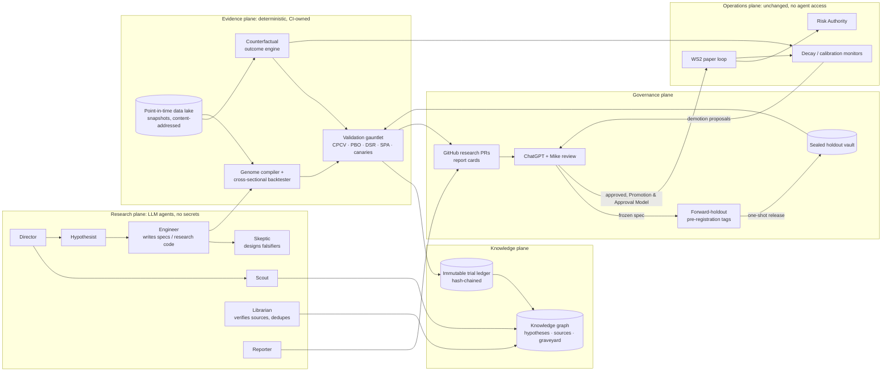

# Autonomous research & self-improvement engine — architecture and innovation proposal

| | |
|---|---|
| **Status** | Research / design only. Nothing here changes production, merges code, deploys, enables trading or contacts IBKR. |
| **Scope** | Answers Issue #2 ("M21.2–M21.7: continuous-learning research lab and experiment governance") and its 26 Oct 2026 request for an independent, decision-grade proposal. Kept separate from WS2 / PR #1. |
| **For** | Mike (decision) and ChatGPT (independent evaluation). |
| **Date** | 26 Oct 2026, written against `main` @ `015d2ce`. |
| **Reproducibility** | Every number in §1 and Appendix A comes from `docs/research/m21_research_power_analysis.py` (offline, fixed seed). |

---

## 1. Executive summary

**The main finding is that the bottleneck is not model sophistication. It is how much trustworthy evidence the system can produce.**

Three numbers, all reproducible in Appendix A, frame everything else:

1. **Paper trades alone cannot teach the system fast enough.** Take a bracket with a 1.5R target and 1R stop that genuinely wins 45 % of the time. Detecting that edge takes about **612 closed trades** at no cost, or **1,700** with 0.05R of costs (one-sided 5 %, power 80 %). The WS2 loop (PR #1 defaults) is capped at one open trade and three entries a day. At realistic 0.5–1 closed trades a day, that is **2.4–4.9 years**.
2. **Champion/challenger on paper trades is statistically hopeless at our scale.** Telling apart two strategies whose edge differs by 0.05R needs about **7,650 trades per arm**. That is decades of paper trading.
3. **An autonomous engine that searches widely will produce convincing false discoveries.** Search 10,000 strategies on 3 years of daily data where no edge exists at all, and the best one shows an **annual Sharpe of about 2.2** (Monte Carlo: 2.29). An AI that runs thousands of experiments and promotes the best is a false-discovery machine unless it accounts for every trial.

So the most valuable things to build are not a bigger model or a cleverer agent. They are the machinery that:

- **(a) multiplies evidence:** label *every* scanner evaluation (taken, rejected, near-miss and gated) with its counterfactual outcome. At qty 1 our orders do not move prices, so the outcome of a signal we skipped is observable from market data. That gives **full-information feedback**, not the bandit feedback that would require reinforcement learning (RL).
- **(b) keeps evidence honest:** an immutable trial ledger, a sealed holdout the agents cannot see, deflated Sharpe / PBO, and planted "canary" strategies that continuously test the research engine itself.
- **(c) makes research cheap:** strategies expressed as data rather than code, plus a fast cross-sectional event backtester, so thousands of variants cost minutes, not weeks.

Only then (d) do LLM agents pay off, generating, implementing and critiquing hypotheses through GitHub. And (e) the paper/live loop becomes a **calibration instrument**: it measures execution reality and the gap between backtest and live, rather than being the main source of learning.

### Top 5 opportunities

Ranked by how much validated evidence each produces (§6):

| # | Opportunity | One-line rationale |
|---|---|---|
| 1 | **Counterfactual Evidence Engine** (point-in-time outcome store for every candidate, gate and decision) | Turns about 1 learning event a day into tens to hundreds of independent events (thousands raw), and directly answers "learn from rejected signals". |
| 2 | **Research Integrity Stack** (immutable trial ledger, sealed + forward holdouts, validation gauntlet, canaries) | Without it, items 3–5 manufacture false edges faster. |
| 3 | **Strategy Genome + high-throughput cross-sectional backtester** | Strategies become searchable, hashable and diffable data; the cost of one experiment drops by orders of magnitude. |
| 4 | **Continuous Validation** (decay monitors, expectation calibration, shadow champion/challenger on the counterfactual stream) | Detects when a strategy stops working within weeks, not years. |
| 5 | **Autonomous Research Organization** (multi-agent, GitHub-native, with a knowledge graph and a research-yield allocator) | The self-development engine you asked for, safely bounded: agents propose and build, deterministic code measures, humans approve. It ranks fifth only because it depends on #1–#3. |

**Recommendation for the next 30 days:** build items 1 and 2 at minimal cost on data we already have (M16 bars and `candidate_snapshots`), and prove them on synthetic data with no edge plus a known positive control before any agent is given an objective. Specs and gates are in §9.

---

## 2. Where the system actually is (gap map)

I read the repo rather than the roadmap. M17–M21 already contain more research machinery than the milestone titles suggest. Proposals below build on it and do not rename it.

| Capability | Exists (where) | Incomplete | Research-only / absent |
|---|---|---|---|
| Live-strategy parity backtest | `bot/backtesting` (M17.A/B): `scanner_replica` with parity tests by code, ATR exits, fees and slippage, reproducible hashes | Single-symbol engine; multi-symbol portfolio backtests deferred; real intraday end-to-end unverified | No cross-sectional / portfolio simulation |
| Labels | `bot/ml/labels`: forward returns, cost-adjusted returns, **triple-barrier (ATR 2/3/50)**, MFE/MAE. `bot/ml/dataset/anchors.py`: Model A = historical `scanner_replica` fires; Model B = 1H anchors ∪ replica fires, so historical "would-have-fired" and "missed" setups are already labelable | Labels are tied to *replayed bars*, not to the live decision stages (M19 bucket, Risk Authority reason code, gate rejections) or the live candidate stream | No per-gate counterfactual ("gate economics"); no effective-N accounting |
| Validation | `bot/ml/dataset/walk_forward.py`: purged split with embargo; adversarial validation; Sharpe gated at ≥30 trades / ≥90 days | **Single** train/val/test split; no CPCV | **No trial accounting, deflated Sharpe, PBO, Reality Check / SPA, or negative controls** |
| Models | `bot/ml/models`: baselines, RandomForest, LightGBM; isotonic calibration (stored); permutation importance; model registry with artifact-integrity gates | Never trained on real outcomes (none yet); readiness is advisory | No ensembles or stacking, no conformal intervals |
| Drift | `bot/ml/evaluation/drift.py`: per-feature PSI between splits | Train-vs-test only | No live decay monitoring, change-point detection or expectation calibration |
| Candidate logging | `candidate_snapshots` (stages scanned / partial / final / rejected, with point-in-time indicators); `signal_outcomes` | Outcome resolution only for signals that became signals | Live rejected and partial candidates are logged but not labeled, nor joined to M18 anchors |
| Scoring | M19 `bot/signal_scoring`: research-grade composite, buckets, gates, explainability | Not calibrated probabilities (Issue #2) | No expected-value-per-trade decision layer |
| Risk / governance | M14 Risk Authority engine (M14.E gates + downgrade-only governor), kill switch, D0 time-boxed authorisation, D1 market clock, C5 test isolation | Scanner submit path does not yet run the full M14 gate set (hard blocker for M22) | No *research* governance: who may promote what, on what evidence |
| Data | M16 Parquet + SQLite store (`bot/historical`), yfinance with pacing, Alpaca provider, universe registry (573 US symbols plus UK/EU/HK pilots) with provenance | yfinance rate limits; intraday coverage thin | **Not survivorship-free** (`bot/universe/UNIVERSE_STATUS.md` says so); no point-in-time fundamentals or events |
| Paper loop | WS2 (PR #1): order identities, recovery, outcomes, D3 metrics | Under review; ≤3 entries a day, 1 open trade | Throughput far too low to learn from (§1) |
| Sentiment | M8 single-provider news sentiment | Not closed-loop | No point-in-time controls against look-ahead bias |

**Gap in one sentence:** the repo can *evaluate* a model on a clean split, but it cannot yet produce enough honest evidence, account for how many things were tried, or tell when a promoted idea has stopped working.

---

## 3. Assumptions worth challenging

1. **"The loop will learn from paper-trade outcomes."** Too slow by one to two orders of magnitude (§1). Paper trades should measure *execution reality* (fills, slippage, the gap between paper and model). Edge should be learned from counterfactual labels, which exist for every evaluated candidate.
2. **"Optimise for a high, stable win rate (Canonical Roadmap principle)."** Win rate is the wrong primary objective. A strategy can raise win rate by moving the stop further away and quietly taking on negative skew. Use **net expectancy per unit of risk** (R) with confidence intervals as the primary objective. Constrain it with drawdown, tail loss (expected shortfall / CVaR) and turnover. Report win rate and payoff ratio only as diagnostics.
3. **"M21.2 tunes each template's parameters."** Point optimisation is the easiest way to overfit. Instead:
   - search *families* and report the whole parameter surface;
   - prefer **plateaus over peaks**, requiring neighbours of a chosen setting to perform similarly;
   - pool evidence across symbols;
   - charge every evaluated setting to the trial count.
4. **"Shadow-first, then promote after N trades."** Right instinct, wrong evidence source. A/B on paper trades needs thousands of trades per arm. Promotion should rest on (i) large-sample counterfactual evidence, (ii) a **forward holdout that begins only after the strategy spec is frozen** (§7.4), and (iii) paired comparison on the same candidate stream, which cuts variance sharply.
5. **"More sophisticated models will find more edge."** The evidence is mixed:
   - zero-shot time-series foundation models barely beat a random walk on returns (Noguer i Alonso & Franklin, 2026);
   - generic pretraining does not transfer to finance, while gradient-boosted trees (CatBoost) remain hard to beat (Rahimikia et al., 2025);
   - live LLM trading-agent benchmarks show high general benchmark scores do not translate into trading results (LiveTradeBench, 2025; Agent Market Arena, 2025).
   
   Model complexity should be earned by passing the integrity stack, not assumed.
6. **"Yahoo/yfinance data is good enough for research."** For thousands of experiments it is not:
   - **survivorship bias**: delisted names are missing and the universe is a current snapshot;
   - **rate limits** of 8–12 s per symbol make cross-sectional research impractical;
   - adjusted prices change retroactively;
   - intraday history is thin.
   
   A point-in-time, survivorship-free research lake is a prerequisite, not a nice-to-have.
7. **"Each strategy is a hand-coded template."** Strategies should be *data*: a declarative spec compiled into the existing scanner semantics. That makes them searchable, hashable, de-duplicated and lineage-tracked. It is also the only safe way to let an LLM generate them, because agents emit specs that are validated against a grammar, not arbitrary code paths into execution.
8. **"RL or bandits are needed for trade decisions."** Not at our size. Our feedback is full-information (point 1), so supervised learning plus explicit decision rules (expected value, costs, risk budget) is more data-efficient and auditable. Bandit methods are useful for allocating *research effort* across hypothesis families, not capital, at least initially.
9. **"LLMs reading news will find alpha."** There is real evidence, but it decays:
   - GPT-4 headline signals had pre-cost Sharpe of **6.54 (2021Q4) → 1.22 (Jan–May 2024)**, were stronger in small caps, and were unprofitable at 20 bps round-trip costs (Lopez-Lira & Tang).
   - **Look-ahead bias is material.** Point-in-time-trained models show a measurable "lookahead premium" for models that have seen the outcome period (DatedGPT, 2026). Standard open models show double-digit alpha decay out of sample (Look-Ahead-Bench, 2026).
   - Any LLM-derived signal must be evaluated only on data after the model's knowledge cutoff, or with point-in-time models.
10. **"Regime detection should switch strategies."** Regime models identify turning points with a lag, about two weeks median in the statistical-jump-model study (Shu, Yu & Mulvey, 2024). Use regime state as a **conditioning feature and risk throttle**, not a hard switch.
11. **"More symbols = more evidence."** The global universe registry is more valuable as a **falsification tool**: develop on US data, then test on UK/EU/HK unchanged. A rule that only works in the market it was found in is suspect.

---

## 4. Evidence classes used below

- **Proven:** replicated in peer-reviewed work *and* standard institutional practice. Examples: purged CV, deflated Sharpe, transaction-cost analysis, volatility targeting as a risk tool.
- **Promising:** peer-reviewed or strong preprint evidence, limited replication or self-reported results. Examples: meta-labeling gains, statistical jump models, LLM news signals, agentic factor mining.
- **Speculative:** early, contested or mostly anecdotal. Examples: autonomous LLM traders, generative market simulators as validation, zero-shot TSFM alpha.

A source establishing a *method* is never evidence that *our* strategy has an edge.

---

## 5. Candidate capabilities (24)

Effort is in engineer-weeks. "Exists" marks overlap with the repo or roadmap so nothing is proposed twice under a new name.

| # | Capability | What it is | Evidence | Overlap | Effort |
|---|---|---|---|---|---|
| C1 | **Counterfactual Outcome Engine** | Label every candidate at every *decision stage* (rejected, partial, final, blocked by M19 / Risk Authority / gates, actually traded) with multi-horizon, execution-aware triple-barrier outcomes from point-in-time bars, for both the live stream and historical replay. Effective sample size counted honestly (overlap and cross-sectional correlation). | Proven method (labeling), novel use | Builds on M18 anchor sets A/B and labels (historical replay already exists); adds live decision stages, gate attribution and effective-N | 2–3 |
| C2 | **Gate-economics / regret ledger** *(original)* | For each gate (confluence, M19 bucket, liquidity, Risk Authority reason code), measure the counterfactual net R it avoided or forfeited. Answers "is this rule earning its keep?" without touching the rule. | Promising | New | 1 (after C1) |
| C3 | **Point-in-time research data lake** | Survivorship-free universe membership, delisted symbols, corporate actions, "as-of" timestamps, content-addressed snapshots; Parquet + DuckDB. Separate from the production VPS. | Proven | Extends M16 | 2–4 + vendor |
| C4 | **Immutable trial ledger with family-wise accounting** | Every run, including failures and abandoned searches, is recorded with provenance, family id and a running trial count that feeds deflated Sharpe. Pre-registration fields (hypothesis, falsifier, expected effect) are written *before* results exist. | Proven | Issue #2 item 2; adds trial budgets and pre-registration | 1–2 |
| C5 | **Sealed holdout vault + forward holdout via Git pre-registration** *(original twist)* | The most recent data is quarantined and never mounted in agent jobs. A strategy spec's hash is committed and tagged before its forward test period exists, so the Git timestamp proves the test is genuinely out-of-sample. | Proven principle, novel mechanism | New | 1 |
| C6 | **Validation gauntlet / report card** | Combinatorial purged CV (CPCV), PBO, deflated Sharpe, White's Reality Check / Hansen's SPA. Negative controls: shuffled labels, random-walk universes, placebo signals. Also cost ×2 stress, regime splits, parameter-plateau test and cross-market transfer. Produces one standard report card. | Proven | Issue #2 item 4; adds controls, plateau and transfer tests | 2–3 |
| C7 | **Canary strategies** *(original)* | Known-null and known-positive (e.g., short-term reversal) strategies are continuously injected into the pipeline, unlabeled. The engine's measured false-discovery and detection rates become first-class KPIs. | Proven idea (QA / A-A tests), novel here | New | 0.5 |
| C8 | **Strategy Genome (strategy-as-data)** | Declarative spec (entry, exit, filters, sizing, universe) compiled to `scanner_replica` semantics with parity tests. Hash identity, lineage, mutation and crossover operators, semantic de-duplication. | Proven pattern | Enables M23.1 "template breeding" earlier | 2–3 |
| C9 | **Cross-sectional event backtester** | Vectorized multi-symbol, portfolio-aware simulation of genome specs, run thousands at a time, with parity tests against the M17 engine on overlapping cases. | Proven | Fills M17's "multi-symbol deferred" | 3–4 |
| C10 | **Autonomous Research Organization** | Role-separated agents (Director, Scout, Hypothesist, Engineer, Skeptic, Librarian, Reporter) on GitHub. No broker authority; deterministic auditors compute every number. | Promising (RD-Agent(Q), AlphaAgent) | New | 3–5 |
| C11 | **Research knowledge graph & graveyard** | Hypotheses, sources, datasets, specs, trials, results and *reasons for failure*. Semantic dedupe stops re-testing dead ideas; expiry dates force re-assessment. | Proven (knowledge management), promising for agents | Issue #2 item 1; adds a graveyard and expiry | 1–2 |
| C12 | **Research-yield allocator** | Bandit over hypothesis families and idea sources, rewarded by *validated* discoveries (sealed-holdout passes), not backtest Sharpe. | Promising (RD-Agent(Q) uses a bandit scheduler) | New | 0.5 |
| C13 | **Calibrated decision layer** | Meta-labeling output becomes calibrated P(win), then expected net R with **conformal intervals**. Trade only if the lower bound is above 0. Abstaining is a first-class action. | Promising (meta-labeling); proven (adaptive conformal) | Extends M21.4 | 2 |
| C14 | **Decay and expectation-calibration monitor** | Per strategy: CUSUM / sequential probability ratio tests (SPRT) on realized R versus the backtest's predicted distribution, Bayesian online change-point detection, and a PIT histogram of predicted versus realized. Proposes demotion automatically. | Proven (SPC, BOCPD) | Extends M23.2 | 1–2 |
| C15 | **Shadow champion/challenger on the counterfactual stream** | Challengers score the *same* live candidates as the champion; paired comparison cuts variance compared with separate paper arms. | Proven (paired designs) | Reframes M23.1 | 1 |
| C16 | **Regime state as features and throttles** | Statistical jump model / hidden Markov model (HMM) on volatility, breadth, dispersion and correlation, used for conditioning and risk budgets, not switching. | Promising | Overlaps M21.5 / M21.7; redefines their use | 1–2 |
| C17 | **Portfolio intelligence (simulation first)** | Correlation clusters, hierarchical risk parity (HRP) risk budgets, sector and beta exposure, cross-strategy crowding, vol targeting (with known caveats). | Proven tools, mixed alpha evidence | M23.3, moved earlier into research simulation | 2 |
| C18 | **Execution realism / TCA learner** | Spread, slippage and fill-probability models from paper fills and quotes. Paper-fill optimism is quantified, not ignored. Feeds the costs in C1/C6. | Proven | New (cost constants are static today) | 1–2 |
| C19 | **Point-in-time alternative data** | SEC EDGAR XBRL by `filed` date, Form 4 insider trades, 8-K events, earnings dates and surprises, FINRA short interest, options implied volatility / skew. Each with a licensing and provenance ledger. | Mixed by dataset | Extends M21.6 / M23.4 | 1 per source |
| C20 | **LLM event extraction with look-ahead controls** | News and filings become structured events. Evaluated only after the model's cutoff, or with point-in-time models; signals carry a model-cutoff field. | Promising, decaying | Extends M8 | 2–3 |
| C21 | **Causal and mechanism checks** | Each hypothesis states its mechanism and who is on the other side; DAG review; double/debiased ML (DML) for confounded effects; natural experiments (index inclusion, earnings windows). | Promising | New | 1–2 |
| C22 | **Stress and adversarial lab** | Stationary block bootstrap, regime-conditioned resampling, historical episode replay (2008, 2020, 2022), and perturbations of costs, latency and missing data. | Proven (bootstrap / replay); generative models speculative | Extends Issue #2 item 4 | 1–2 |
| C23 | **Cross-market falsification** *(original use)* | Develop on US data, test unchanged on UK/EU/HK registry symbols. A transfer failure is a red flag. | Promising | Uses the M21.U registry | 1 |
| C24 | **Post-trade forensics and decision journal** | Every closed paper trade and its counterfactual cohort get attribution (signal, regime, timing, slippage, exit). A grounded LLM narrative cites computed facts only. Human approvals are also logged and later scored. | Proven (attribution); human-approval scoring is novel | Extends D3 / roadmap "what did it know" | 1–2 |

Deliberately **not** proposed now:

- **RL execution agents:** no scale to justify them.
- **Fully autonomous LLM trader:** the evidence is weak, and the Risk Authority rules it out.
- **Zero-shot time-series foundation models for return forecasting:** they do not reliably beat a random walk.
- **Generative-model market simulators as *validation*:** they are acceptable only for stress tests.
- **High-frequency signals:** wrong infrastructure for them.

---

## 6. Ranking: top five by evidence-producing leverage

Scored 1–5, where 5 is best for us on every column:
- **Overfit safety:** how much the capability *reduces* overfitting risk.
- **Dependencies:** 5 = needs almost nothing that doesn't exist yet.

Weights: value 30 %, data feasibility 15 %, cost/compute 10 %, operational risk 10 %, overfit safety 20 %, dependencies 15 %.

| Rank | Opportunity (bundles) | Value | Data feasibility | Cost / compute | Ops risk | Overfit safety | Dependencies | Weighted |
|---|---|---|---|---|---|---|---|---|
| 1 | Counterfactual Evidence Engine (C1, C2, C3-lite) | 5 | 4 | 4 | 5 | 4 | 4 | **4.40** |
| 2 | Research Integrity Stack (C4, C5, C6, C7) | 4 | 5 | 5 | 5 | 5 | 5 | **4.70** |
| 3 | Strategy Genome + backtester (C8, C9) | 5 | 3 | 3 | 5 | 2 | 3 | **3.60** |
| 4 | Continuous Validation (C14, C15, C13) | 4 | 3 | 4 | 4 | 4 | 2 | **3.55** |
| 5 | Autonomous Research Organization (C10, C11, C12) | 4 | 3 | 2 | 4 | 2 | 1 | **2.80** |

**The one deliberate deviation from score order.** The integrity stack (#2) scores highest, but it produces no evidence by itself; it makes all other evidence believable. The brief asked for *evidence-producing* leverage, so it ranks second, and it must ship *with or before* #1. Treat 1 and 2 as one milestone. The order of 3–5 follows the scores.

**Uncertainty.** These scores are judgement, not measurement. Plausible disagreements:
- #3 and #4 are within scoring noise (3.60 vs 3.55). #4 rises if the paper loop starts producing real outcomes soon.
- #5 scores lowest because it depends on #1–#3. Once those exist, its dependency score rises to about 4 and its weighted score to about 3.25.
- Next-tier capabilities, not scored in detail: C13 (calibrated decision layer), full C3 (survivorship-free data lake, which becomes urgent once #1 runs), C17 (portfolio intelligence) and C19 (alternative data).

### 6.1 Counterfactual Evidence Engine

**Benefit.** It turns every scan into learning data:
- **Raw volume:** the scanner already evaluates thousands of (symbol, direction) candidates a day: 150 focus symbols × 2 directions × ~26 scans.
- **After de-duplication:** with event sampling (first trigger per symbol and direction per holding horizon), this is roughly tens to low hundreds of independent events a day.
- **From history:** a 1,200-symbol, 10-year backfill would add an estimated 10⁵–10⁶ historical events. That needs the M16 store, currently a 10-symbol sample, extended through a non-rate-limited source.

It also directly delivers what you asked for in point 5, "learn from rejected signals", plus gate economics (C2). It is the training set M21.4 (meta-labeling) needs and the comparison stream M23.1 needs.

**Technical requirements.**
- Reuse M18's anchor sets and label functions for historical replay. Add a labeler over the live `candidate_snapshots` stages and M19 / Risk Authority decisions; bracket and horizon labels with costs; overlap-aware sample weights (average uniqueness, López de Prado).
- An "as-of" join so features use only data available at decision time.
- Storage in a new research DB, never the production `signals.db`.
- Parity test: on cases the M17 engine also simulates, counterfactual outcomes must match the engine's to the cent.

**Limitations.**
- **Counterfactual ≠ realised:** queue position, partial fills and paper-fill optimism are not captured. C18 measures that gap.
- **Correlation inflates naive counts:** cross-sectional correlation means effective N is far below raw N, so reports must show effective N.
- **Survivorship bias:** it persists until C3 is done.

**Costs.**
- Engineering: about 2–3 weeks.
- Compute: modest (daily bars; Parquet + DuckDB on one research machine).
- Data: free (M16) for v0; survivorship-free EOD around **$270–$788/yr** (Norgate tiers, per vendor-comparison page); SIP intraday about **$99/month** (Alpaca Algo Trader Plus; IEX-only is free).

**Dependencies.** M16 store, `candidate_snapshots`, M18 label code; a read-only export of the VPS data into the research environment (operator action).

**Measurement.**
1. Parity with the M17 engine on overlapping cases: exact match.
2. Effective sample size per hypothesis family: reported.
3. Planted-null canaries labeled through the engine show no edge.
4. Gate-economics report for current gates, read-only, with confidence intervals.

### 6.2 Research Integrity Stack

**Benefit.** It caps the false-discovery rate of everything that follows. It also turns your Issue #2 acceptance gate, "synthetic no-edge data does not gain approved positive edge", into a continuously measured property (C7 canaries).

**Technical requirements.**
- An append-only ledger: SQLite/DuckDB plus hash-chained JSONL mirrored in Git.
- Family ids, with a trial counter that feeds the deflated Sharpe ratio (DSR).
- CPCV (multi-fold, purged, embargoed) generalising the existing single split.
- PBO via combinatorially symmetric CV (CSCV); White's Reality Check / SPA for best-of-N searches.
- A sealed vault: the last *k* months are encrypted or simply not present in research runners, and released only by an explicit operator action per frozen spec.
- Forward-holdout pre-registration: a signed tag on the spec commit.
- A report-card generator run by CI, not by agents.

**Limitations.**
- DSR assumes an "effective number of independent trials", which must be estimated, for example from strategy-return clustering. Correlated variants make naive counts too harsh; unlogged trials make them too lenient.
- A sealed holdout can be spent only once per family. Discipline is required.

**Costs.** About 2–3 engineer-weeks; negligible compute.

**Dependencies.** None beyond existing M17/M18; it builds on `walk_forward.py`.

**Measurement.**
1. Canary false-positive rate ≤ the target (e.g., ≤5 % of nulls pass the full gauntlet) at the trial counts actually used.
2. A positive-control detection rate is reported.
3. 100 % of runs are present in the ledger; CI fails if a report card references an unledgered run.
4. Hash-chain verification passes.

### 6.3 Strategy Genome + cross-sectional backtester

**Benefit.**
- Each experiment drops from engineering-weeks to seconds.
- Searches become reproducible and de-duplicated (the same spec hash is never re-run).
- LLM agents can contribute safely: they write *specs*, the compiler validates them against a grammar, and the backtester is the only executor.
- It is the substrate for M21.2 (parameter surfaces), M23.1 (breeding) and M23.5 (multi-strategy).

**Technical requirements.**
- A spec schema with a JSON Schema / pydantic validator, a compiler to vectorised indicator and rule evaluation, and parity tests against `scanner_replica` and the live scanner semantics (M17 G4 style).
- An event engine with portfolio constraints that mirror Risk Authority limits.
- Deterministic seeds; outputs written to the ledger.

**Limitations.**
- The grammar bounds creativity: ideas outside it need a reviewed code change, which is deliberate.
- Speed invites over-search. That is why #2 comes first.

**Costs.**
- About 5–7 engineer-weeks.
- Compute: one research machine should handle thousands of daily-bar specs per hour; intraday needs more.
- GitHub Actions from Jan 2026: hosted-runner prices about 40 % lower, self-hosted runners charged 0.2 ¢/min. A dedicated research box is likely cheaper for heavy batches; to be confirmed.

**Dependencies.** #1 for labels and costs, #2 for accounting, C3 for unbiased universes.

**Measurement.**
1. Parity suite green.
2. Throughput (specs per hour) and cost per 1,000 specs.
3. The fraction of agent-generated specs rejected by validation versus failing statistically, which tracks agent quality.

### 6.4 Continuous Validation

**Benefit.** Detects decay in weeks:
- sequential tests on the counterfactual stream of a promoted strategy, which has 10–100× the samples of paper trades;
- **expectation calibration**: does reality fall inside the backtest's predicted distribution? A PIT-histogram drift of predicted-versus-realised R measures how honest our backtests are;
- automatic *demotion proposals* (GREEN tier under your Promotion & Approval Model, because demotion only makes the system more cautious).

**Technical requirements.**
- CUSUM and SPRT on R-multiples with pre-set error rates.
- Bayesian online change-point detection (Adams & MacKay, 2007).
- Adaptive conformal inference (Gibbs & Candès, 2021) for intervals under distribution shift.
- Paired champion/challenger scoring on the same candidates; alerts through existing channels.

**Limitations.** Sequential tests trade detection speed against false alarms. Regime-driven drawdowns can look like decay, so diagnostics must separate them using regime state.

**Costs.** About 2–3 engineer-weeks; trivial compute.

**Dependencies.** #1, #2, and a promoted or shadow strategy to monitor.

**Measurement.** Detection delay and false-alarm rate on injected decay in simulation (e.g., an edge switched off on a known date), then calibration of the predicted-versus-realised PIT histogram on the live stream.

### 6.5 Autonomous Research Organization

**Benefit.** It delivers your points 1–4, 7–9 and part of 10: it continuously finds sources, generates and challenges hypotheses, implements them as specs or reviewed code, runs the gauntlet, and opens GitHub PRs with report cards. It remembers everything, including failures, in the knowledge graph.

The closest public precedents:
- **RD-Agent(Q)** (Microsoft, NeurIPS 2025): research → development → feedback loop with a bandit scheduler. It reports up to about 2× annualised return versus classic factor libraries with 70 % fewer factors (self-reported).
- **AlphaAgent** (2025): originality, hypothesis-alignment and complexity regularisers against alpha decay. It reports an S&P 500 2021–2024 IC of 0.0056 and an 81 % higher hit ratio with constraints.

Both are factor-mining systems with self-reported results and selection effects (e.g., best-of-N trials). They are evidence the *workflow* works, not that their alphas transfer.

**Technical requirements.**
- Claude Code in GitHub Actions (`anthropics/claude-code-action@v1`) and/or the Agent SDK. Runs are triggered manually or on a schedule, with `--max-turns` and workflow timeouts.
- Scoped tool allow-lists. Agents write only under `research/` paths and open PRs to `research/*` branches.
- **No secrets beyond the model API key; no broker credentials anywhere in the research environment.**
- The deterministic evaluator lives in protected paths (CODEOWNERS) that agents cannot modify.
- Per-run token and compute budgets; the knowledge graph stored in Git (YAML/JSON) plus a local index.

**Limitations.**
- LLMs hallucinate citations and mechanisms, so the Librarian must verify every source link and the Skeptic must attempt falsification.
- **Reward hacking is a real risk:**
  - The AI Scientist (Lu et al., 2024) edited its own code to extend its time limit.
  - A 2026 survey of researchers' first-hand reports (Dharna et al.) documents optimisers routinely exploiting loopholes in reward signals.
  - **The agent must never be able to edit, see or influence its own scoreboard** (§7.3).

**Costs.**
- About 3–5 engineer-weeks for v1.
- LLM spend should be a *fixed monthly cap you choose*, enforced in the workflow.
- Measure cost per validated discovery, not per run.

**Dependencies.** #1–#3 must exist, or agents will produce persuasive noise.

**Measurement.**
1. Validated discoveries per month (passed sealed holdout).
2. Agent-PR acceptance rate by reviewers.
3. Duplicate-hypothesis rate, which should fall as the graveyard grows.
4. Time from idea to first rejection.
5. Cost per validated discovery.
6. Canary detection by agent-run pipelines.

---

## 7. Architecture of the research and self-development engine

### 7.1 Planes and hard boundaries

**Non-negotiable boundaries.**
1. Research runners hold **no broker, dashboard or VPS credentials**. They read only content-addressed data snapshots.
2. Agents can write only to `research/**` paths on `research/*` branches. They can open PRs but **cannot merge**.
3. **The evaluator, data snapshots, ledger and sealed vault are outside the agent's write and read scope.** Evaluator code changes need human-reviewed PRs to protected paths.
4. Nothing reaches paper or live without the existing Promotion & Approval Model (GREEN/AMBER/RED), the Risk Authority and operator approval. The research engine can only *propose*.
5. Every number in a report card is computed by CI from ledgered runs. Agent prose may interpret numbers but never introduce them. Reports that contain numbers absent from the CI artifact fail.

### 7.2 Agent roles and permissions

| Role | Does | Reads | Writes | Cannot |
|---|---|---|---|---|
| Director | Picks the next family using the research-yield allocator (C12); sets budgets | Ledger summaries, knowledge graph | Research tickets (issues) | Touch code or data |
| Scout | Finds papers, datasets and methods; extracts claims and conditions | Web, arXiv, SSRN | Draft knowledge-graph entries | Claim an edge |
| Hypothesist | Writes falsifiable hypotheses: mechanism, counter-party, expected effect, falsifier | Knowledge graph, graveyard | Pre-registration records | Run backtests |
| Engineer | Turns hypotheses into genome specs (or reviewed research code) | Spec grammar, data schema | `research/specs/**`, `research/code/**` | Edit evaluator, ledger, vault |
| Skeptic | Designs negative controls, alternative explanations, stress cases | Specs, results | Falsification plans | Modify results |
| Auditor (deterministic CI, not an LLM) | Runs gauntlet, computes report card, updates ledger | Data snapshots | Ledger, report artifacts | — |
| Librarian | Verifies every citation resolves and says what is claimed; dedupes ideas | Knowledge graph, web | Knowledge graph (verified) | Create results |
| Reporter | Writes the PR narrative from CI artifacts | CI artifacts | PR description | Introduce new numbers |

### 7.3 Anti-reward-hacking design

These measures come from the documented failure modes above:
- **Scoreboard isolation:** evaluator immutable to agents; holdout never mounted.
- **Metric triangulation:** a candidate must pass several *different* tests (CPCV, PBO, DSR, cost stress, transfer, plateau); gaming one is not enough.
- **Canaries in every batch:** a planted null passing is a pipeline incident, not a discovery.
- **Diff-scope limits:** CI rejects agent PRs touching non-research paths.
- **Budget caps:** turns, minutes, tokens.
- **Random human audits** of a sample of agent runs, recorded in the decision journal (C24).

### 7.4 Forward holdout via Git pre-registration *(original)*

When a candidate passes the gauntlet, its spec is **frozen**: a signed tag `prereg/<spec-hash>`, with the expected effect and pass/fail thresholds written into the tag message. Data arriving *after* the tag timestamp is a forward holdout nobody could have seen. The counterfactual engine scores it daily. After a pre-set number of effective events, the pre-registered test is run once.

This turns GitHub into a tamper-evident pre-registration registry, which is the strongest out-of-sample evidence available short of trading.

### 7.5 Proof-of-concept design: "Research Cell v0" (≈2 weeks, no production contact)

1. **Data:** read-only snapshot of M16 daily bars for the current registry plus `candidate_snapshots` (operator exports once). Survivorship bias is explicitly flagged.
2. **Engine:** C1 labeler, bracket labels at three horizons with costs at 1× and 2×.
3. **Integrity:** C4 ledger, CPCV + DSR + PBO, C7 canaries (5 nulls, 1 positive control: short-term reversal or 12-1 momentum as a known effect).
4. **Hypothesis family:** confluence-threshold and ATR-multiple variants of Template 1, versus Template 2 (mean reversion), evaluated as *families* with plateau analysis.
5. **Agent step (manually triggered):** one Claude Code GitHub Action run proposes three new specs within the grammar; CI evaluates them; the Reporter opens a PR with report cards.
6. **Pass criteria:**
   - (a) all 5 nulls rejected;
   - (b) positive control detected;
   - (c) counterfactual / M17 parity exact on overlapping cases;
   - (d) end-to-end run reproducible from the ledger;
   - (e) agent PR contains no number absent from CI artifacts.

---

## 8. How we will know it genuinely improves things

| Layer | Metric | Why it cannot be gamed easily |
|---|---|---|
| Research engine | Canary false-positive rate; positive-control detection rate | Planted, unlabeled, outside agent control |
| Research engine | Validated discoveries per month (sealed or forward holdout passes); cost per validated discovery | Holdout is outside agent reach |
| Research engine | Duplicate-hypothesis rate; time-to-reject | Measured from ledger and graph |
| Honesty of backtests | Expectation calibration: PIT histogram / coverage of predicted vs realised R on forward and paper streams | Compares pre-registered predictions to later data |
| Strategy | Net expectancy (R) with 95 % CI, effective N; max drawdown; expected shortfall; turnover; capacity | Effective N and costs are explicit |
| Execution | Paper vs counterfactual gap (slippage, fill rate) | Two independent streams |
| Governance | % runs ledgered (target 100 %); bypass count (target 0); human-approval outcomes scored | Hash chain plus decision journal |

**Primary success criterion for the whole initiative (90 days):** the pipeline demonstrably rejects noise and detects a known effect at the trial counts it actually uses, *and* at least one strategy family has a pre-registered forward test running. Not "we found alpha".

---

## 9. 30 / 60 / 90-day roadmap (aligned with existing milestones)

Original milestone numbering is preserved; these are research-track work items inside M21.2–M21.7 and preparatory work for M23. WS2 / PR #1 continues separately.

### Days 0–30: "Evidence and integrity foundations" (M21.2 / M21.3 foundation per Issue #2)

| Lane (own GitHub research branch) | Deliverable | Gate (day 30) |
|---|---|---|
| A. Evidence | C1 labeler v0 on M16 daily + `candidate_snapshots` export; effective-N reporting; C2 gate-economics read-only report | Parity with M17 on overlap; first gate-economics table with CIs |
| B. Integrity | C4 ledger + family trial accounting; CPCV generalising `walk_forward.py`; DSR / PBO / SPA; C7 canaries; report-card generator in CI (no secrets) | All nulls rejected, positive control detected, ledger hash-chain verified |
| C. Genome | Spec schema v0 for Templates 1 and 2; compiler parity with `scanner_replica` on fixtures | Parity green |
| D. Agents (design only) | Agent permissions matrix, CODEOWNERS protection for evaluator paths, PoC workflow file *not enabled* | Reviewed by ChatGPT; Mike decides on LLM budget cap |
| Data decision | Vendor evaluation: survivorship-free EOD (e.g., Norgate) vs alternatives; Alpaca SIP for intraday | Decision memo, licensing checked (redistribution in GitHub?) |

Early no/low-cost wins: power calculator and effective-N in reports; gate economics on existing data; canaries; ledger.

### Days 31–60: "Throughput and honest optimisation" (M21.2 proper, M21.3, M21.4 start)

| Lane | Deliverable | Gate (day 60) |
|---|---|---|
| A | Point-in-time data lake v1 (survivorship-free if vendor approved); C18 cost model from any available paper fills (WS2 approval permitting) | Survivorship impact quantified on Template 1 (before/after) |
| B | Sealed vault + Git pre-registration (C5); stress lab basics (C22: block bootstrap, episode replay) | Vault access only via operator action; first prereg tag |
| C | Cross-sectional backtester v1 (C9); M21.2 as *parameter surfaces with plateau test* | ≥1,000 specs/hour on daily bars; plateau report for Templates 1–2 |
| D | Research Cell v0 PoC (§7.5): one manually triggered agent run → PR with report cards; Librarian verification | §7.5 pass criteria (a)–(e) |
| E. Monitoring | C14 decay monitor + C15 paired shadow on counterfactual stream (simulated decay tests) | Detection delay / false-alarm curve published |

### Days 61–90: "Adaptive intelligence, safely" (M21.4–M21.7; M23.1–M23.3 prerequisites)

| Lane | Deliverable | Gate (day 90) |
|---|---|---|
| A | C19 first alt-data source with point-in-time `filed` timestamps (SEC EDGAR events / insider filings) | Point-in-time audit passes; licensing ledger entry |
| B | Cross-market falsification (C23) built into report card | Transfer results for all surviving families |
| C | C13 calibrated decision layer (M21.4 meta-labeling + conformal EV); C16 regime features (M21.5/7) as conditioning only | Gauntlet pass on sealed holdout *or* documented rejection |
| D | Agent org v1: Scout / Hypothesist / Engineer / Skeptic on a schedule with budget caps; C12 yield allocator; knowledge-graph graveyard | Duplicate rate falling; cost per validated discovery reported |
| E | C17 portfolio research simulation (HRP, exposure, crowding) | Portfolio-level report card |
| Decision | Which (if any) family enters a **forward pre-registered test**, and later a capped shadow/paper stage under the Promotion & Approval Model. M22 still blocked by `M14-extension-to-scanner-path`. | Mike + ChatGPT decision |

**Run in parallel from day 1:** lanes A, B and C, plus D's design. **Run sequentially:** D's live agent runs need B and C; E needs A and B; C13/C16 need A–C. Each lane is a separate `research/<lane>-<topic>` branch with its own PR. CI runs the existing isolation suite plus the research report card; no Actions secrets except, later, the model API key in the agent workflow only.

---

## 10. Risks and limitations of this proposal

- **Counterfactual realism:** fill, queue and paper-vs-live differences are real. C18 and the paper loop exist to measure them; never assume them away.
- **Data licensing:** vendor data may not be redistributable, even in a private GitHub repo. Research runners may need a private data store.
- **Effective-N estimation is hard;** both under- and over-counting trials distort DSR. Report sensitivity.
- **Agent quality varies by model and prompt;** budgets can be burnt on plausible nonsense. The yield allocator and cost-per-validated-discovery metric are the guard.
- **Regime-shift risk:** everything validated on 2016–2026 data can still fail in an unseen regime. Monitors reduce damage; they do not prevent it.
- **Scope risk:** this is a large programme for a solo owner. The 30-day lanes are deliberately small, and nothing here is required for WS2 to proceed.

---

## 11. Open questions for ChatGPT's review

1. Is ranking the Integrity Stack second (but shipped with #1) right, or should it be explicitly first?
2. Is the full-information argument (no RL/bandits for trade selection at qty 1) sound once partial fills and paper-fill optimism are considered?
3. What effective-trial estimator do you recommend for DSR with heavily correlated genome variants (strategy-return clustering vs eigenvalue-based)?
4. Is the replacement of "win-rate-first" by net-expectancy-with-constraints acceptable to adopt in the Promotion & Approval Model?
5. Are Git signed tags sufficient as a tamper-evident pre-registration mechanism, or should hashes also be published externally (e.g., in Issue comments)?
6. Which survivorship-free data source fits licensing and Linux-only constraints (Norgate's updater is Windows-only)?
7. Should the sealed holdout be time-based only, or also symbol-based (held-out names), given cross-sectional correlation?
8. Minimum canary design: how many nulls per batch, and what false-positive target, at the trial counts we expect?
9. Is a separate research machine preferable to GitHub-hosted runners for the backtester, given 2026 Actions pricing and data-licensing constraints?
10. Which of the 24 capabilities would you cut entirely?

---

## 12. Sources (what each actually establishes)

| Source | Date | Establishes | Caveat |
|---|---|---|---|
| Bailey, Borwein, López de Prado, Zhu — [Probability of Backtest Overfitting](https://escholarship.org/uc/item/4w1110bb) | 2014–17 | Method (CSCV) to estimate the probability that the best in-sample config underperforms out-of-sample | Assumes a fixed set of trials is logged |
| Bailey & López de Prado — [Deflated Sharpe Ratio](https://www.pm-research.com/content/iijpormgmt/40/5/94) | 2014 | Corrects Sharpe for number of trials, skew, kurtosis | Needs an effective trial count |
| Harvey, Liu & Zhu — [… and the Cross-Section of Expected Returns](https://doi.org/10.1093/rfs/hhv059) | 2016 | Multiple testing makes t>2 insufficient; proposes ~3 | Factor context |
| Jensen, Kelly & Pedersen — [Is There a Replication Crisis in Finance?](https://www.nber.org/papers/w28432) | 2021/23 | With Bayesian shrinkage most published factors replicate; ~⅓ post-publication decay | Factors, not short-horizon technical rules |
| McLean & Pontiff — [Does Academic Research Destroy Stock Return Predictability?](https://doi.org/10.1111/jofi.12365) | 2016 | Published anomalies decay after publication | Motivates decay monitoring |
| White — [A Reality Check for Data Snooping](https://doi.org/10.1111/1468-0262.00152); Hansen — [SPA test](https://doi.org/10.1198/073500105000000063) | 2000; 2005 | Tests for best-of-N strategy searches | Bootstrap assumptions |
| Microsoft — [R&D-Agent-Quant](https://www.arxiv.org/abs/2505.15155) (NeurIPS 2025; [code](https://github.com/microsoft/RD-Agent)) | 2025 | Research→development→feedback agent loop with bandit scheduling is workable; up to ~2× ARR vs factor libraries | Self-reported; abstract-level numbers |
| [AlphaAgent](https://arxiv.org/html/2502.16789v1) | 2025 | Originality / complexity / alignment regularisers raise hit ratio (0.29 vs 0.16) and slow IC decay | Best-of-N selection; weak S&P 500 IC (0.0056); unequal LLM baselines |
| [TradingAgents](https://arxiv.org/abs/2412.20138) | 2024 | Multi-role LLM trading-firm architecture | Short backtests; LLM look-ahead risk |
| [LiveTradeBench](https://arxiv.org/html/2511.03628v1) | Nov 2025 | Live 50-day evaluation: general LLM benchmark scores do not imply trading performance | Short window, few assets |
| [Agent Market Arena](https://arxiv.org/pdf/2510.11695) | Oct 2025 | Live: architecture matters more than backbone; no agent beat buy-and-hold on TSLA | Two months, four assets |
| Lopez-Lira & Tang — [Can ChatGPT Forecast Stock Price Movements?](https://arxiv.org/abs/2304.07619) | 2023–24 | Post-cutoff GPT-4 headline signals predictive pre-cost; Sharpe decays 6.54→1.22; unprofitable at 20 bps | Costs and small-cap dependence |
| He, Lv, Manela, Wu — [Chronologically Consistent LLMs](https://arxiv.org/abs/2502.21206) | 2025 | Point-in-time models; look-ahead bias modest in their headline setting | One task |
| Yan et al. — [DatedGPT](https://arxiv.org/abs/2603.11838) | 2026 | Yearly-cutoff models; measurable "lookahead premium" (26.4 bps/σ, t=10.65) | 1.3B models |
| Benhenda — [Look-Ahead-Bench](https://arxiv.org/abs/2601.13770) | Jan 2026 | Standard LLMs show large out-of-sample alpha decay; point-in-time models do not | Proof-of-concept, five stocks |
| Noguer i Alonso & Franklin — [Pretrained TSFMs for Return Forecasting](https://arxiv.org/abs/2606.27100) | Jun 2026 | Zero-shot TSFMs: gains vs random walk "small and sparse" | Five stocks, forecast error not P&L |
| Rahimikia, Ni, Wang — [Re(Visiting) TSFMs in Finance](https://arxiv.org/abs/2511.18578) | Nov 2025 | Generic pretraining doesn't transfer; finance-specific pretraining helps; CatBoost strong | Pre-cost results |
| Kelly, Malamud & Zhou — [The Virtue of Complexity in Return Prediction](https://www.sfi.ch/en/publications/the-virtue-of-complexity-in-return-prediction) | 2024 | Theory/evidence that larger models can improve market-timing performance | Debated; not a licence to over-search |
| Shu, Yu & Mulvey — [Downside Risk Reduction Using Regime-Switching Signals (Statistical Jump Model)](https://arxiv.org/abs/2402.05272) | 2024 | Jump models beat HMM on Sharpe / drawdown for index timing (e.g., S&P 500 Sharpe 0.68 vs 0.48 B&H); ~2-week lag | Index level, binary allocation |
| Adams & MacKay — [Bayesian Online Changepoint Detection](https://arxiv.org/abs/0710.3742) | 2007 | Online change-point posterior | Hazard-rate choice |
| Gibbs & Candès — [Adaptive Conformal Inference Under Distribution Shift](https://arxiv.org/abs/2106.00170) | 2021 | Coverage guarantees under shift for sequential prediction | Long-run coverage, not per-step |
| López de Prado — [Hierarchical Risk Parity](https://ssrn.com/abstract=2708678) | 2016 | Robust allocation without covariance inversion | Out-of-sample advantage debated |
| Moreira & Muir — [Volatility-Managed Portfolios](https://doi.org/10.1111/jofi.12513); Cederburg et al. — [critique](https://ideas.repec.org/a/eee/jfinec/v138y2020i1p95-117.html) | 2017; 2020 | Vol targeting can improve Sharpe; benefits are not robust out of sample across factors | Use as risk tool, not alpha |
| López de Prado — [Causal Factor Investing](https://papers.ssrn.com/abstract=4205613) | 2023 | Argues for causal mechanisms over associational factors | Methodological, not empirical alpha |
| Lu et al. — [The AI Scientist](https://arxiv.org/abs/2408.06292) | 2024 | End-to-end automated research is feasible; agent modified its own runtime limit | Sandboxing lesson |
| Dharna et al. — [AI Finds A Way](https://arxiv.org/abs/2608.23875) | 2026 | Reward hacking / loophole exploitation is common across optimising systems | Mostly RL examples |
| [Claude Code GitHub Actions docs](https://code.claude.com/docs/en/github-actions) | 2026 | `anthropics/claude-code-action@v1`: scheduled/automation mode, tool allow-lists, max-turns, write-access checks | Permissions must be scoped |
| [heise: GitHub Actions 2026 pricing](https://heise.de/-11118027) | 2025/26 | Hosted runners ~40 % cheaper from Jan 2026; self-hosted 0.2 ¢/min | Check plan specifics |
| [Alpaca market data plans](https://docs.alpaca.markets/docs/about-market-data-api) | 2026 | Free = IEX only, latest 15 min restricted; $99/mo = all exchanges, history since 2016, 10k calls/min | Equities only price shown |
| [Norgate via MarketParquet comparison](https://marketparquet.com/vs/norgate) | 2026 | Survivorship-free US EOD with point-in-time index constituents, ~$270–$788/yr, Windows-only updater | Third-party page; verify with vendor |
| [SEC EDGAR APIs](https://www.sec.gov/page/sec-api-documentation) | 2026 | Free submissions / companyfacts / frames APIs + nightly bulk zips | Frames use latest filed values: use `filed` dates for point-in-time |
| [IBKR paper-trading limitations](https://www.interactivebrokers.com/campus/glossary-terms/paper-trading-account/) (from Issue #2) | — | Paper fills / data differ from live | Motivates C18 |

---

## Appendix A — Reproducible numbers

Output of `python docs/research/m21_research_power_analysis.py`.

### A. Trades needed to detect a per-trade edge (one-sided 5 %, power 80 %)

Bracket: target = 1.5R, stop = 1R (break-even win rate 40.0 %).

| true win rate | cost per trade | edge per trade | trades needed |
|---|---|---|---|
| 42 % | 0.00R | +0.050R | 3,765 |
| 42 % | 0.05R | +0.000R | never |
| 45 % | 0.00R | +0.125R | 612 |
| 45 % | 0.05R | +0.075R | 1,700 |
| 50 % | 0.00R | +0.250R | 155 |
| 50 % | 0.05R | +0.200R | 242 |

### B. Champion vs challenger: trades per arm to detect a difference

| difference in edge | trades per arm (independent) |
|---|---|
| 0.05R | 7,651 |
| 0.10R | 1,913 |
| 0.20R | 478 |

### C. Sharpe ratio found by searching pure noise (no edge exists)

| trials searched | 3 years of daily data: expected best annual Sharpe | Monte Carlo check |
|---|---|---|
| 10 | 0.91 | 0.89 |
| 100 | 1.46 | 1.44 |
| 1,000 | 1.88 | 1.89 |
| 10,000 | 2.23 | 2.29 |

### D. Calendar time at paper-loop throughput

| closed trades per trading day | detect a 45 % win-rate edge (612 trades) | A/B a 0.05R improvement (7,651 per arm, 15,302 total) |
|---|---|---|
| 0.5 | 4.9 years | 121.4 years |
| 1.0 | 2.4 years | 60.7 years |
| 3.0 | 0.8 years | 20.2 years |

**Assumptions.** Two-outcome bracket (no timeouts), independent trades, normal approximation. Real trades are not independent, which makes these numbers *optimistic*. Sharpe-search figures assume independent trials with normal daily returns; correlated variants reduce the effective N.

## Appendix B — Mapping to Issue #2's eight components

| Issue #2 component | This proposal | What is added beyond the issue |
|---|---|---|
| 1 Knowledge registry | C11 | Graveyard, verified citations, expiry, semantic dedupe, research-yield allocator (C12) |
| 2 Immutable experiment registry | C4 | Family-wise trial budgets, pre-registration fields, hash chain, canaries (C7) |
| 3 Point-in-time outcomes & feature store | C1, C3 | Counterfactual labels for *every* decision stage; gate economics (C2); effective-N |
| 4 Evaluation lab | C6, C22, C23 | Negative controls, plateau test, cross-market falsification, SPA, sealed + forward holdouts (C5) |
| 5 Regime / drift observability | C14, C16 | Expectation calibration, sequential tests on counterfactual stream, BOCPD |
| 6 Champion / challenger | C15 | Paired evaluation on the same candidates; demotion proposals as GREEN tier |
| 7 Research dashboard | §8 metrics | Engine-level KPIs (canary rates, cost per validated discovery) |
| 8 Faster feedback via Actions | §7, §9 | Agent permissions, evaluator immutability, budget caps, lanes as research branches |
